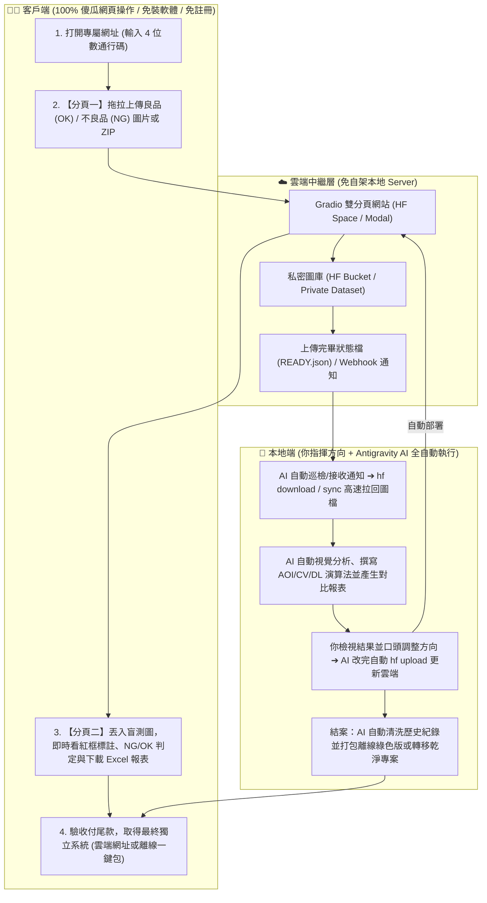

# AI 全自動 AOI / 視覺外包接案與交付實戰手冊 (Hugging Face CLI 核心版)

> **核心定位**：由**人類擔任產品導演（看結果、調方向、收款）**，由 **Antigravity AI Agent 擔任全自動工程師（收圖、寫演算法、轉檔加速、部署雲端、打包交付）**，且**客戶端 100% 透過傻瓜網頁操作（免註冊、免裝環境）**、**本地端免自架伺服器**的零成本/極低成本外包流水線。

---

## 一、 全流程架構總覽

### 四階段角色與關鍵動作對照表

| 階段 | 客戶端動作（全網頁傻瓜操作） | 你（人類指揮官）的動作 | Antigravity AI（全自動執行）的動作與關鍵指令 |
| :--- | :--- | :--- | :--- |
| **1. 開案與環境初始化** | 收到你給的專屬網址與隨機通行碼 | 告訴 AI：「開一個新專案叫 `xxx-aoi`」 | 執行 `hf repos create` 建立私密圖庫 (Bucket/Dataset) 與雙分頁 Gradio Space，設定隨機密碼鎖與單一 Repo 權限之 Fine-grained `HF_TOKEN` Secret |
| **2. 收集訓練樣本** | 在**【分頁一】**選「良品/不良品」，把圖片或 `.zip` 拖進去，按「上傳完畢」 | 收到通知後告訴 AI：「去把客戶傳的圖抓下來開始寫程式」 | 執行 `hf download` / `hf sync` 拉回本地 ➔ 檢視影像特徵 ➔ 自動寫 AOI/AI 程式 ➔ 產出準確率（過殺/漏檢）與視覺化對比圖 |
| **3. 迭代開發與線上盲測** | 在**【分頁二】**丟入產線盲測圖，看紅框標註結果；若有判錯按「回報錯判」 | 看 AI 跑出的結果，出一張嘴下指導棋（如：「反光誤判了，調嚴格一點」），滿意後喊「推上去」 | 修改演算法 ➔ 轉 ONNX 加速 ➔ 執行 `hf upload` 更新 Space ➔ 若客戶回報錯判圖，自動從 `hard_cases/` 拉回修正 |
| **4. 結案收款與交付** | 驗收通過、支付尾款，接收「離線一鍵啟動包 (`.zip`)」或「永久專屬系統」 | 確認收到尾款，告訴 AI：「結案打包交付」 | 撤銷開發 Token、清除敏感測試圖與 Git 歷史紀錄 ➔ 打包 **Windows 免安裝一鍵啟動包 (`.bat`/`.exe`)** 或移交全新乾淨 Repo |

---

## 二、 四大階段具體落地設計與防呆機制

### 階段 1：客戶如何上傳訓練圖片？（極致防呆設計）
傳統製造業/AOI 客戶不懂 Git、不懂コマンド，甚至不會註冊 Hugging Face。因此 AI 撰寫的 Gradio **【分頁一：訓練樣本上傳區】** 具備以下防呆設計：

1. **免註冊、隨機通行碼與權限隔離**：
   * Space 設為公開網址以利客戶直接點開，但在 Gradio 啟用 `auth=("client", "<隨機高強度密碼>")`（禁用 `8888` 等弱密碼），且核心模型權重放置於 Private Repo，Space 端僅使用**限縮單一 Repo 權限的 Fine-grained Token** 讀取，避免洩密。
2. **明確分類按鈕 + 支援整批拖拉與串流 ZIP 解壓**：
   * 畫面上提供超大單選鈕：**`🟢 正常良品 (OK)`** 與 **`🔴 瑕疵不良品 (NG)`**（可擴充刮痕、缺件、髒污等子分類）。
   * 支援一次框選數百張圖片直接拖入，或上傳 `.zip` 壓縮檔（後端採串流解壓並過濾 `__MACOSX`/`Thumbs.db` 與路徑穿越風險，避免記憶體 OOM）。
3. **底層防爆鎖機制（徹底解決 Space 重啟蒸發與 Git Commit Rate Limit）**：
   * **嚴禁每傳一張圖就發一次 Git Commit**（HF 限制每小時約 120 次 commits，傳大量圖必崩潰）；亦**不使用有 5 分鐘同步窗口遺失風險的 `CommitScheduler`**。
   * AI 會在後端直接將圖片串流寫入 **Hugging Face Buckets（S3 相容高速儲存，免 Git Commit 限制）**。
   * 客戶傳完按下 **「✅ 我已全部上傳完畢，通知工程師」** 按鈕並核對檔案落地後，系統自動在雲端寫入 `READY.json` 狀態檔。

---

### 階段 2：AI 如何知道圖片已上傳？如何開始寫 AOI / AI 程式？
1. **純 Hugging Face 自動感知與高速拉檔（免雲端 LLM API Key）**：
   * **HF 任務狀態檔觸發**：客戶按下「上傳完畢」或觸發單張 LLM 解說時，HF Space 直接在私密圖庫（Bucket / Dataset）寫入 `READY.json`（或 `pending_review/` 任務檔）。
   * **本地免開 Port 自動接單**：本地端直接透過 Antigravity `/schedule` 定時巡檢或輕量 `hf` 輪詢腳本偵測到 `READY.json` / `pending_review/` 後，自動喚醒本地 Antigravity / Claude CLI 進場看圖分析，並將結果寫回 HF，完全不需額外設定 Telegram 輪詢或雲端 API Key。
   * **全速拉回本地**：AI 自動執行 `hf download <repo_id> --type dataset --local-dir ./projects/<案名>/data`（若圖庫使用 HF Bucket 則執行 `hf sync`），走 HF 多執行緒高速通道把所有圖片拉回你的本地電腦。
2. **AI 全自動視覺分析與演算法開發**：
   * AI 直接讀取本地 `OK` 與 `NG` 樣本圖進行多模態視覺分析（辨識瑕疵屬於邊緣毛邊、表面刮傷、異物、尺寸偏差或色差）。
   * AI 自動撰寫初版演算法（依場景選擇 OpenCV 形態學/傳統影像處理、PatchCore 無監督異常檢測、或 YOLO 物件偵測），並在本地跑完所有樣本的交叉驗證。
   * AI 在對話視窗中直接呈現 **「原圖 vs 檢測紅框對比圖」** 以及 **「過殺率 (False Positive) / 漏檢率 (False Negative) 統計表」**。
   * **你的角色**：只需看圖下達直覺指令（例如：「*左上角那是治具反光不是刮痕，幫我把那個區域遮罩掉或調高閾值*」），AI 立即改碼重跑。

---

### 階段 3：如何讓客戶自己上傳測試圖片並看到結果？（雙模式線上盲測驗收）
當本地結果令你滿意，AI 執行 `hf upload` 將最新演算法與模型推上 Space。客戶打開同一個網址切換至 **【分頁二：線上盲測驗收區】**，系統提供以下兩種測試模式：

1. **🔍 模式 A：單張精細診斷（結果立即出 + LLM 非同步白話文解說）**：
   * **第 0.1 秒（立即給結果）**：客戶拖入單張盲測圖片後，畫面**立刻**顯示純 CV/ONNX 程式的判定結果：**`🟢 判定：OK (良品)`** 或 **`🔴 判定：NG (檢出 2 處刮痕，耗時 0.12 秒)`**，並在右側圖片精準畫出瑕疵紅框（Bounding Box）或熱力圖，完全不需等待。
   * **背景非同步（晚點補上說明，不干預判定 + 超時容錯）**：系統同時將「原圖 + 紅框圖」寫入 HF 佇列觸發本地 LLM 看圖，網頁說明欄先顯示「*🤖 AI 正在撰寫詳細診斷中...*」，待本地 LLM 寫回 `results/` 後，Gradio 透過 `gr.Timer` 自動將白話文診斷補上（不影響客戶繼續測下一張）。**若超過 30 秒本地端未回應（例如電腦關機），網頁自動顯示「目前 AI 解說員離線中，請直接參考上方純程式判定結果」，避免無限轉圈。註：LLM 僅擔任解說員與收件審查，絕不偷改純程式的 OK/NG 判定，確保與最終離線交付程式 100% 零落差。**
2. **📦 模式 B：整批極速盲測（Batch 純程式掃描 + Excel 驗收報表）**：
   * 客戶可一次丟入 50~200 張盲測圖（或 `.zip`），此模式 **100% 僅執行純 CV/ONNX 程式**，數秒內完成全數掃描，避免逐張呼叫 LLM 造成網頁卡頓。
   * 跑完後除了可在網頁翻頁檢視，還提供 **「📥 下載完整盲測報告 (.xlsx / .csv)」**（內含檔名、判定結果、瑕疵座標、信心分數），方便客戶直接拿去向主管結案報告；若客戶對其中特定幾張 NG 有疑問，可單獨點擊該張圖片觸發 **「🤖 請 AI 解釋這張」**。
3. **「⚠️ 這張判錯了」一鍵回饋閉環**：
   * 畫面旁附設 **「⚠️ 回報此圖判錯（改標為 OK / NG）」** 按鈕。客戶點擊後，該張圖片與正確標籤會自動存回私密圖庫的 `feedback_hard_cases/` 資料夾並觸發 HF 狀態更新。
   * 你只需告訴 AI：「*把客戶剛回報判錯的圖抓下來修好*」，AI 就能針對盲測失敗樣本進行加強訓練與邏輯修正。

---

### 階段 4：最後如何交付？（針對「不懂電腦客戶」的三種實戰交付方案）
傳統手冊建議的「Transfer Ownership（轉移 HF 帳號所有權）」對不懂電腦的傳產客戶通常不可行（客戶不想註冊英文網站、不會綁卡、且直接轉移 Repo 會洩露過去所有的 Git Commit 開發黑歷史）。

AI 會先**撤銷開發期 Token、洗掉所有 Git 歷史紀錄與測試圖**，並依客戶需求打包為以下三種零門檻方案之一：

| 交付模式 | 適用客戶場景 | 客戶最終拿到的交付物（零技術門檻） | AI 自動執行的打包動作 |
| :--- | :--- | :--- | :--- |
| **方案 A：本地離線「一鍵啟動綠色版」** *(🔥 AOI 工廠最愛)* | 工廠產線**禁止連外網**、保密要求高、或要求毫秒級高速反應 | 一個 `.zip` 壓縮檔（放隨身碟或雲端硬碟交付）。解壓後只有一個 **`點我啟動AOI檢測系統.bat`**，滑鼠點兩下自動在瀏覽器跳出檢測畫面（跑在本地 `localhost`） | 使用 Python Embedded / PyInstaller 封裝 `app.py` + ONNX 模型，並內建**環境一鍵健檢腳本**（自動檢查 VC++、CPU AVX2 相容性與防毒白名單） |
| **方案 B：產線機台自動監聽包 (Watchdog)** | 客戶有配合的機台商（PLC / 光學相機自動存圖到特定資料夾） | 一個背景執行程式：只要工業相機把圖存進 `D:\AOI_Input\`，程式在 0.1 秒內自動判讀並把畫好紅框的圖、`result.json` 旗標檔寫入 `D:\AOI_Output\` | 實作**檔案大小穩定檢查 / `.tmp` Atomic Rename**（防搶讀半截圖）、**Heartbeat 心跳檔**（給 PLC 確認程式存活）與 **磁碟 FIFO 自動滾動清理** |
| **方案 C：乾淨雲端專屬網址交付** | 客戶可連外網、希望手機/多台電腦隨時打開網址就能測 | 一個永久專屬的乾淨網址（或幫客戶代辦一個全新 HF 帳號並移交**僅含單一初始 Commit** 的乾淨 Space） | 建立全新無歷史紀錄的 Space，僅上傳最終版編譯後程式碼與權重後執行過戶 |

---

## 三、 雲端平台與 GPU 硬體計費完整評估

### 1. Hugging Face Spaces 硬體等級與計費標準（按分鐘計費）
Spaces 只有在 **Running（運行中）** 時才按分鐘計費；當處於 **Sleeping（休眠）** 或 **Paused（暫停）** 時費用為 **\$0**。

| 硬體等級 | CPU / 記憶體 | GPU 顯存 (VRAM) | 每小時費用 (USD) | AOI / 視覺任務實戰建議 |
| :--- | :--- | :--- | :--- | :--- |
| **CPU Basic** | 2 vCPU / **16 GB RAM** | 無 GPU | **\$0（完全免費）** | **🏆 90% 案件首選**！由 AI 將訓練好的模型轉為 **ONNX Runtime / OpenVINO**，在免費 CPU 上單張推論僅需 0.1~0.4 秒，盲測完全免費！ |
| **CPU Upgrade** | 8 vCPU / 32 GB RAM | 無 GPU | **\$0.03 / hr** (~NT\$1/hr) | 適合需要高併發處理超高解析度大圖的傳統影像處理 |
| **Nvidia T4 (Small)** | 4 vCPU / 15 GB RAM | **16 GB VRAM** | **\$0.40 / hr** (~NT\$13/hr) | **CP 值最高入門 GPU**：適合標準 YOLO、PatchCore、SAM 影像分割模型 |
| **Nvidia L4** | 8 vCPU / 30 GB RAM | **24 GB VRAM** | **\$0.80 / hr** (~NT\$26/hr) | 適合 4K/8K 高解析度工業原圖不縮圖直接推論 |
| **Nvidia A10G** | 4~12 vCPU / 15~46 GB | **24 GB VRAM** | **\$1.00 ~ \$1.50 / hr** | 適合多模型串聯或視覺語言模型 (VLM) 複合檢測 |
| **ZeroGPU (共享動態卡)** | 免費 CPU + 動態切卡 | **48~96 GB VRAM** (H200/Blackwell 切片) | 包含於 **HF PRO (\$9/月)** 或公開額度 | **⚠️ 僅限內部測試**：匿名免註冊客戶每日僅約 2 分鐘共享額度且按超時扣除，極易噴 `Quota Exceeded`，勿用於正式客戶盲測 |

> [!IMPORTANT]
> **付費 GPU 必設「閒置自動休眠 (`sleep_time`)」省錢防呆！**
> 付費 GPU 預設不會自動休眠（放著 24 小時不關會持續扣款）。當需要開啟 T4 GPU 讓客戶盲測時，AI 會透過 SDK 強制設定 **`sleep_time = 900`（閒置 15 分鐘自動休眠）**。客戶點開網址時自動喚醒計費，測完關掉網頁 15 分鐘後自動睡著變回 \$0 元，整個案子盲測下來 GPU 成本通常不到台幣 30 元。

---

### 2. 免自架 Server 的跨平台方案橫向評比

| 評估平台 | 免費額度與計費模式 | 硬體與推論速度 | 客戶傳檔與 AI 自動化整合度 | 定位與推薦指數 |
| :--- | :--- | :--- | :--- | :--- |
| **1. Hugging Face** *(Spaces + Buckets/Datasets)* | **CPU Basic 永久免費** (16GB RAM)；私密儲存空間大；GPU 按分計費 | ONNX 量化後免費 CPU 極順；可隨時切換 T4/ZeroGPU | ⭐⭐⭐⭐⭐ 原生 `hf` CLI 與 Skills，AI 可 100% 全自動操控 | **🥇 主力首選方案** 最適合日常所有 AOI 接案全流程 |
| **2. Modal.com** *(Serverless GPU Cloud)* | **每月免費贈送 \$30 美金**（需綁卡，務必設定 `Spending Limit = $30`）！按「實際運算秒數」計費 | **極致快**！隨傳隨到 T4 / L4 / A10G / A100，冷啟動僅 2~3 秒 | ⭐⭐⭐⭐ 具備 `modal` CLI 與高速 `Modal Volume`，同樣可直接跑 Gradio | **🥈 重度 GPU 最佳備案** 當模型極大必須用 GPU、又不想付 HF 待機費時，用 Modal 每月 \$30 免費額度根本用不完 |
| **3. Cloudflare R2 + HF Space** | R2 每月 **10GB 免費**且免流量費 (Zero Egress Fee) | 運算同 HF Space；儲存走工業級 S3 | ⭐⭐⭐⭐ 適合單案客戶上傳超過 50GB 以上超巨量原圖 | **📦 巨量圖庫擴充方案** 當客戶一次要傳數萬張無損 BMP/TIFF 原圖時搭配使用 |

---

## 四、 標準開案 SOP 指令速查（你只需要對 AI 說的話）

裝妥全域 `hf-cli` Skill 後，你不需要自己記任何複雜參數，每個階段只需對 Antigravity AI 下達以下自然語言指令：

1. **【階段 1：開新案子】**
   > 🗣️ **你對 AI 說**：「*幫我開一個新的 AOI 專案叫 `client-pcb-aoi`，建立私密 Dataset 和帶密碼鎖的雙分頁 Gradio Space。*」
2. **【階段 2：拉圖與寫第一版程式】**
   > 🗣️ **你對 AI 說**：「*客戶把樣本傳上去了，幫我拉回本地，分析一下 OK 跟 NG 的差異，寫第一版檢測程式跑出報表給我看。*」
3. **【階段 3：調優與部署盲測】**
   > 🗣️ **你對 AI 說**：「*把誤判的那幾張修正一下，轉成 ONNX 加速後，推上 Space 讓客戶做線上盲測。*」
4. **【階段 4：結案打包交付】**
   > 🗣️ **你對 AI 說**：「*客戶驗收通過付錢了！幫我把這套系統打包成 Windows 點兩下就能離線跑的一鍵啟動包，並把雲端測試資料清理乾淨。*」

---

## 五、 接案前與驗收防呆關卡（商業與現場保底）

1. **開案前置關卡（Feasibility & NDA）**：
   * 確認客戶產線資料**是否允許上傳公有雲**（若受嚴格 NDA 限制，改走加密硬碟/區網 NAS 收圖 + 離線驗收）。
   * 確認**光學取像可行性**（相機/光源是否固定、最小瑕疵像素是否清晰可見），光學無解不接案。
2. **黃金測試集與 UAT 量化驗收**：
   * 階段 2 結束前，雙方必須簽認一組固定數量的 **《黃金測試集 (Golden Test Set)》**，並明訂驗收指標（如：漏檢率 $\le X\%$、過殺率 $\le Y\%$、單張耗時 $\le Z$ 秒），達標即結案收款，避免無限追加新圖要求免費修改。
3. **環境漂移免責與授權邊界**：
   * 合約明確區分「軟體 Bug 保固」與「現場環境漂移（燈管老化、鏡頭沾油、來料批次色差）」；後者屬於模型再訓練（Retraining）付費維運範疇。
