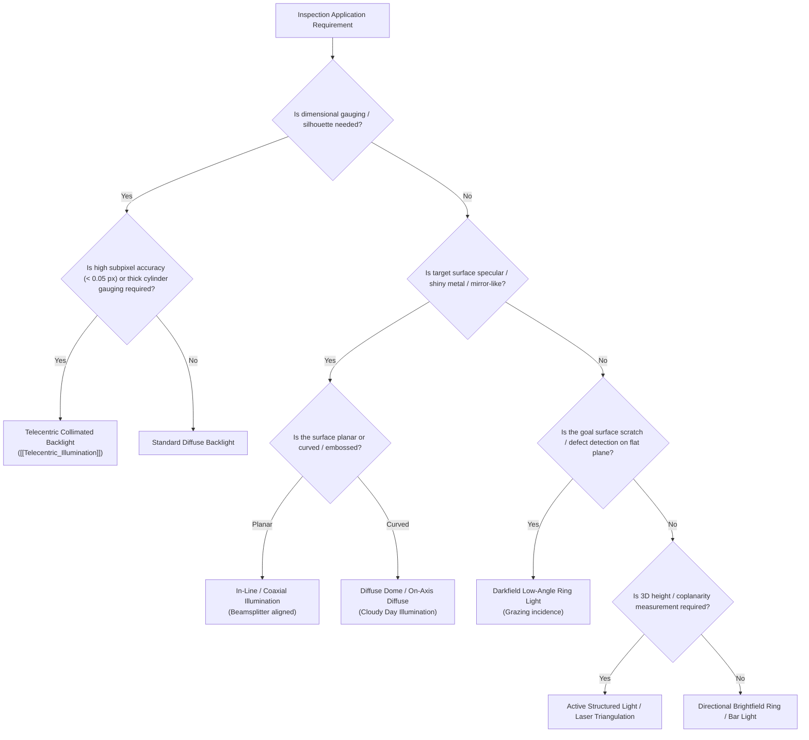
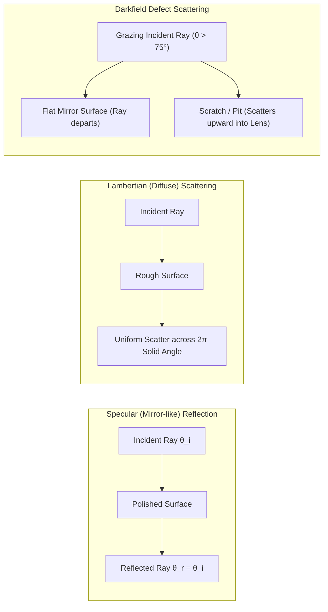

# Comparison: Machine Vision Illumination Techniques Matrix

> **Scope**: Systematic optical engineering decision matrix comparing lighting geometries for industrial automation  
> **Source Anchor**: Layer 1 Edmund Optics Notes (`[[choose-the-correct-illumination]]`, `[[in-line-illumination-considerations]]`, `[[using-structured-illumination]]`)  
> **Target Algorithms**: [[Thresholding]], [[Edge_Detection_and_Caliper]], [[Particle_Analysis]], [[Pattern_Matching]]

---

## 1. High-Level Decision Flowchart

---

## 2. Systematic Technical Trade-off Matrix

| Illumination Technique | Surface Compatibility | Defect / Feature Target | Pros & Strengths | Cons & Limitations | Optimal NI Vision API Entities |
| :--- | :--- | :--- | :--- | :--- | :--- |
| **Directional Brightfield** | Matte, diffuse, paper, printed cardboard | 2D barcodes, printed text, color verification | Low cost, flexible mounting, compact footprint | Severe specular hotspots on metals; harsh shadows | [[imaqMatchPattern3]], [[imaqReadBarcode]] |
| **Darkfield (Low-Angle)** | Specular, polished glass, silicon wafers | Micro-scratches, dust, laser engravings, embossed text | High contrast black background; defects appear bright | Extremely sensitive to working distance; low overall optical efficiency | [[imaqThreshold]], [[imaqCountParticles]], [[imaqParticleFilter4]] |
| **Diffuse Dome (Cloudy Day)** | Curved, stamped metals, blister packaging | OCR on shiny metal cans, solder ball inspection | Completely eliminates glare and harsh shadows | Bulky mechanical envelope; object must sit directly inside dome port | [[imaqAutoThreshold2]], [[imaqReadText3]] |
| **In-Line / Coaxial** | Highly planar specular (wafers, CCDs, polished glass) | Cracks in glass, semiconductor die alignment, wire bonds | Perfectly perpendicular illumination; fits compact spaces | 50% light loss at beamsplitter; severe hot spots on diffuse surfaces | [[imaqFindEdge2]], [[imaqFitLine]], [[imaqMatchGeometricPattern2]] |
| **Standard Backlight** | Any opaque or semi-translucent object | General outer profile, web edge guiding | Simple, low cost, high SNR silhouette ($> 50 \text{ dB}$) | Edge bleed / penumbra on thick cylinders ($1-3 \text{ px}$ error) | [[imaqFindEdge2]], [[imaqMeasureParticle]] |
| **Telecentric Collimated Backlight** | Precision turned parts, threaded fasteners, pins | Critical dimensional metrology, micro-burr detection | Subpixel repeatability ($\le 0.02 \text{ px}$); zero boundary diffuse scattering | Illuminator must be as large as FOV; high optical cost | [[imaqFindEdge2]], [[imaqFitCircle2]], [[imaqGetDistance]] |
| **Structured Light** | Matte to semi-matte 3D objects | Height profile, coplanarity, weld bead geometry | Direct 3D topographic reconstruction with single camera | Occlusion / shadow zones; sensitive to surface specular spikes | [[imaqFindEdge2]], [[imaqTransformPixelToRealWorld]] |
| **Cross-Polarized (90°)** | Highly reflective metals, PCB solder, blisters | Surface printing, characters, code reading through glare | Completely extinguishes specular glare & hot spots | 75%–85% optical loss; polarizers degrade at high LED temperatures | [[imaqAutoThreshold2]], [[imaqReadBarcode]] |
| **Parallel-Polarized (0°)** | High-polish mirrors, silicon, polished glass | Sub-micron surface scratches, oil film, fingerprints | Accentuates specular reflections over diffuse background | Highly sensitive to surface tilt; requires fine rotational alignment | [[imaqFindEdge2]], [[imaqThreshold]] |
| **UV Illumination (365 nm)** | Fluorescent coatings, glass, semiconductors | Glue dispensing inspection, conformal coating, micro-scratches | High-contrast fluorescence (SNR > 45 dB); halved Airy disk spot | UV eye hazard; standard optical glass absorbs UV (requires quartz optics) | [[imaqColorThreshold]], [[imaqCountParticles]], [[imaqMeasureParticle]] |
| **NIR (850 / 940 nm)** | Printed packaging, dark plastics, factory cells | Barcode reading, internal clips through plastic, ambient rejection | Penetrates dyes; standard CMOS compatible; immune to room lighting | Lower silicon QE (~10–20%); color information completely lost | [[imaqFindEdge2]], [[imaqFitCircle2]], [[imaqMatchPattern3]] |
| **SWIR (1050–1550 nm)** | Silicon ingots, solar cells, liquid containers | In-die micro-cracks, bump alignment, liquid fill levels | Penetrates silicon wafers; 1450 nm water absorption peak | Requires expensive InGaAs sensors; specialized SWIR-coated lenses | [[imaqParticleFilter4]], [[imaqThreshold]] |

---

## 3. Surface Physics & Scattering Behavior

---

## 4. Engineering Rules of Thumb

1. **The Inverse Square Law**: Doubling the distance from light source to object reduces illuminance by a factor of 4 ($I \propto 1/d^2$).
2. **Polarization for Specular Glare**: When inspecting semi-gloss surfaces where dome lighting is mechanically infeasible, place linear polarizing filters over both the light source and camera lens in a crossed ($90^\circ$) orientation to extinguish direct specular reflections.
3. **Wavelength vs. Surface Color**:
   - To make a colored feature appear **bright** (higher intensity), illuminate with the **same color** wavelength.
   - To make a colored feature appear **dark** (high contrast for segmentation), illuminate with the **complementary color** wavelength (e.g., green light on red printing).

---

## 5. Associated References

- [[Illumination_Techniques]]
- [[Telecentric_Illumination]]
- [[Standard_vs_Telecentric_Lighting]]
- [[Thresholding_Methods_Comparison]]
