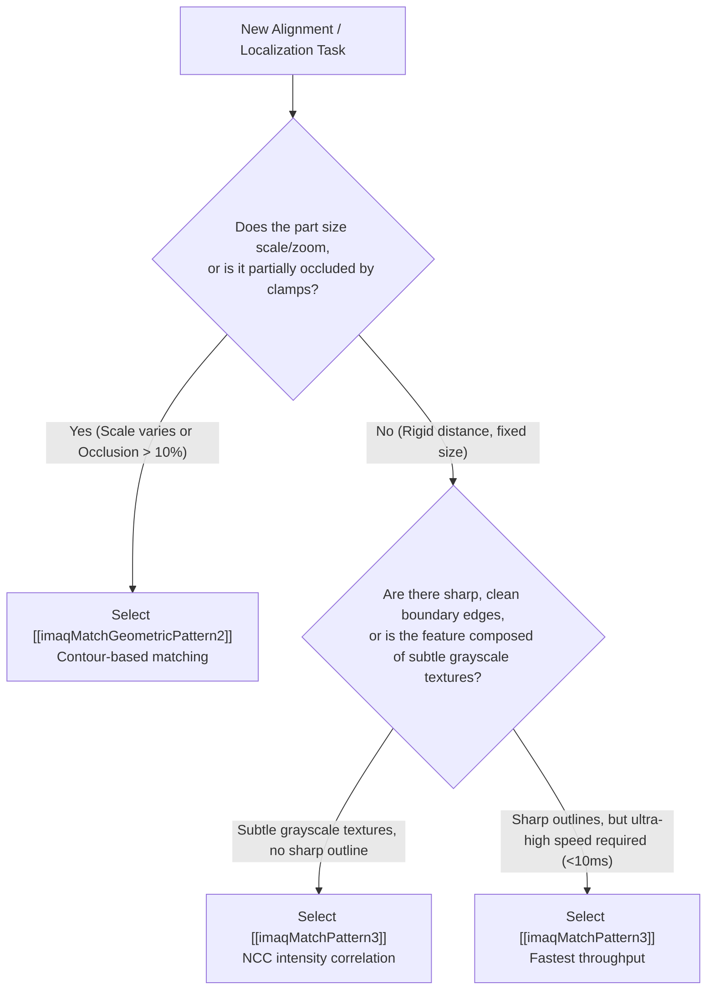

# Comparison: Normalized Cross-Correlation (NCC) vs Geometric Matching

> **Category**: Decision Matrix / Template Matching & Object Registration  
> **Parent Concepts**: [[Pattern_Matching|Concept: Grayscale Pattern Matching]], [[Geometric_Matching|Concept: Geometric Matching]]

---

## 1. Technical Comparison Matrix

| Inspection Metric | Grayscale NCC Matching ([[imaqMatchPattern3]]) | Geometric Matching ([[imaqMatchGeometricPattern2]]) |
| :--- | :--- | :--- |
| **Search Mechanism** | Normalized cross-correlation of pixel intensities | Subpixel edge curves & geometric topology hashing |
| **Typical Execution Speed** | **Ultra Fast** ($5 \sim 15 \text{ ms}$ via image pyramid) | **Moderate** ($15 \sim 40 \text{ ms}$ depending on curve count) |
| **Scale / Zoom Tolerance** | **None** (Fails if scale shifts $> 3\%$) | **Wide** ($0.5\times \sim 2.0\times$ continuous scale) |
| **Rotation Invariance** | Supported ($0^\circ \sim 360^\circ$), slower | Native ($0^\circ \sim 360^\circ$) with identical latency |
| **Partial Occlusion Tolerance** | Poor (Degrades rapidly if occlusion $> 10\%$) | **Exceptional** (Finds matches with up to $40\%$ occluded) |
| **Illumination Robustness** | Linear brightness/contrast shift invariant | **Complete invariance** to non-linear contrast inversion |
| **Surface Texture Requirement** | Requires rich internal texture & grayscale contrast | Requires sharp, distinct geometric boundaries & edges |
| **Blur / Defocus Tolerance** | High (Smooth grayscale gradients match well) | Low (Defocus destroys high-frequency edge gradients) |

---

## 2. Selection Flowchart for AI Agents

---

## 3. Related Entities & Concepts

- [[Pattern_Matching]]
- [[Geometric_Matching]]
- [[imaqMatchPattern3]]
- [[imaqMatchGeometricPattern2]]
- [[imaqLearnPattern5]]
- [[imaqLearnGeometricPattern]]
