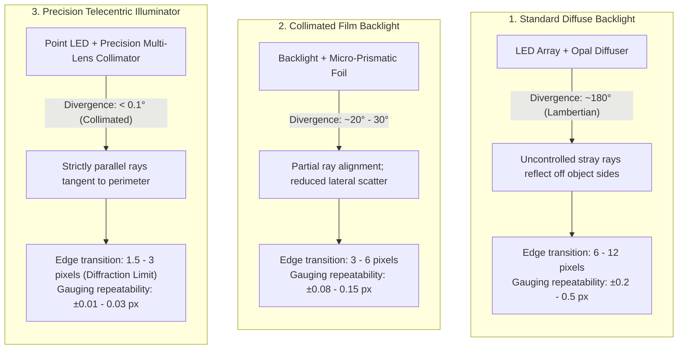
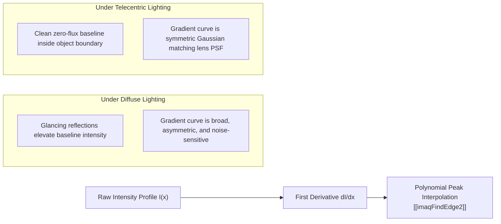

# Comparison: Standard Diffuse vs. Collimated vs. Telecentric Illumination

> **Scope**: High-precision dimensional metrology trade-off between backlighting architectures  
> **Source Anchor**: Layer 1 Edmund Optics Notes (`[[telecentric-illumination-why-you-need-it-in-machine-vision-applications]]`)  
> **Target Algorithms**: [[Edge_Detection_and_Caliper]], [[Coordinate_Systems_and_Calibration]]

---

## 1. Physical Architecture Comparison

Precision dimensional gauging requires stable, repeatable edge boundaries. The choice of backlight determines whether the captured edge profile represents the true physical perimeter or a false optical penumbra.

---

## 2. Technical Comparison Matrix

| Engineering Metric | Standard Diffuse Backlight | Collimated Film Backlight | Precision Telecentric Illuminator |
| :--- | :--- | :--- | :--- |
| **Ray Bundle Divergence** | Near $180^\circ$ (Lambertian $2\pi$ steradians) | $20^\circ - 30^\circ$ semi-collimated | $< 0.1^\circ$ (Strictly parallel chief rays) |
| **Edge Gradient Width** | $6 - 12 \text{ pixels}$ (Soft transition) | $3 - 6 \text{ pixels}$ (Moderate) | $1.5 - 3 \text{ pixels}$ (Diffraction limited) |
| **Thick Cylinder Error** | High ($5 - 25 \ \mu\text{m}$ negative shift) | Moderate ($2 - 8 \ \mu\text{m}$ error) | Zero ($< 0.5 \ \mu\text{m}$ systematic shift) |
| **Subpixel Repeatability** | $\sigma \approx \pm 0.2 - 0.5 \text{ px}$ | $\sigma \approx \pm 0.08 - 0.15 \text{ px}$ | $\sigma \le \pm 0.02 \text{ px}$ (Peak stability) |
| **Working Distance (Z)** | Critical ($< 20 \text{ mm}$ recommended) | Moderate ($20 - 50 \text{ mm}$) | High flexibility ($100 - 500 \text{ mm}$) |
| **Optical Clear Aperture** | Flexible; oversized plates common | Flexible; standard rectangular formats | Must exceed object FOV ($\ge 100\%$ FOV) |
| **Mechanical Footprint** | Extremely flat panel ($10 - 25 \text{ mm}$) | Flat panel ($15 - 30 \text{ mm}$) | Bulky cylindrical optic (Length $150 - 400 \text{ mm}$) |
| **Relative Cost Index** | $1.0\times$ (Lowest) | $2.5\times$ (Budget upgrade) | $8.0\times - 15.0\times$ (Capital investment) |

---

## 3. Mathematical Edge Profile Analysis

Let $I(x)$ represent the 1D intensity profile across the boundary of an opaque cylinder:

### Why Telecentric Lighting Eliminates Systematic Gauge Error
Under diffuse illumination, glancing reflections on the cylinder perimeter create an elevated intensity plateau right inside the physical boundary. This causes the inflection point ($50\%$ threshold or $\frac{d^2I}{dx^2} = 0$) to migrate **inward toward the center of the object**:
- The detected diameter appears **smaller than physical reality**.
- Recalibrating with a 2D flat target does not correct this error because a flat target has zero cylindrical sidewall reflection.
- **The Telecentric Solution**: Parallel rays graze the cylinder tangent without scattering into the telecentric imaging lens, rendering the detected boundary identical to the true physical cylinder diameter.

---

## 4. Selection Recommendations

1. **Choose Standard Diffuse Backlight when**:
   - Inspecting flat, 2D sheet metal stampings, thin film webs, or punched paper.
   - Dimensional tolerance is coarse ($\pm 0.1 \text{ mm}$ or larger).
   - Space constraints restrict optical path thickness to $< 30 \text{ mm}$.

2. **Choose Collimated Film Backlight when**:
   - Budget constraints prevent purchasing a dedicated telecentric illuminator.
   - Part thickness is moderate ($1 - 5 \text{ mm}$), and moderate edge sharpening is sufficient.

3. **Choose Precision Telecentric Illuminator when**:
   - Measuring round turned parts, needle diameters, valve shafts, or screw threads.
   - Subpixel accuracy ($\le 0.05 \text{ px}$) or micrometer-level metrology is legally required.
   - Paired with an object-space or double-telecentric imaging lens.

---

## 5. Associated References

- [[Telecentric_Illumination]]
- [[Illumination_Techniques]]
- [[Edge_Detection_and_Caliper]]
- [[Coordinate_Systems_and_Calibration]]
