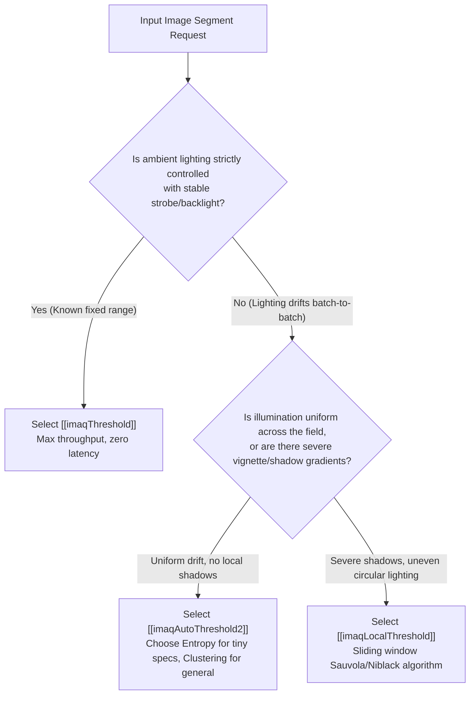

# Comparison: Global vs Auto vs Local Thresholding Strategies

> **Category**: Decision Matrix / Image Segmentation  
> **Parent Concept**: [[Thresholding|Concept: Image Thresholding & Segmentation]]

---

## 1. Technical Comparison Matrix

| Evaluation Dimension | Global Static Threshold ([[imaqThreshold]]) | Auto Histogram Threshold ([[imaqAutoThreshold2]]) | Local Adaptive Threshold ([[imaqLocalThreshold]]) |
| :--- | :--- | :--- | :--- |
| **Computational Complexity** | $O(N)$ (Extremely fast, $< 0.5 \text{ ms}$) | $O(N + K)$ (Fast, $\approx 1.5 \text{ ms}$) | $O(N \cdot W^2)$ (Heavy, $10 \sim 40 \text{ ms}$) |
| **Sensitivity to Lighting Drift** | **Extremely High** (Fails if light drops 10%) | **Low** (Self-adjusting cutoff) | **Zero** (Handles severe uneven gradients) |
| **Handling Gradient Shadows** | **Fails Completely** | **Fails** (Bimodal split washes out) | **Excels** (Local sliding window) |
| **Small Particle Retention** | Depends on manual tuning | Excels with `IMAQ_THRESH_ENTROPY` | Good (Sauvola prevents ghost blobs) |
| **Input Parameters Required** | Explicit $[lower, upper]$ bounds | Number of classes, `ThresholdMethod` | Window width/height, deviation weight |
| **Primary Failure Mode** | Ambient daylight interference | Bimodal assumption breakdown | Window size smaller than object size |

---

## 2. Selection Flowchart for AI Agents

---

## 3. Related Entities & Concepts

- [[Thresholding]]
- [[Binary_Morphology]]
- [[imaqThreshold]]
- [[imaqAutoThreshold2]]
- [[imaqLocalThreshold]]
