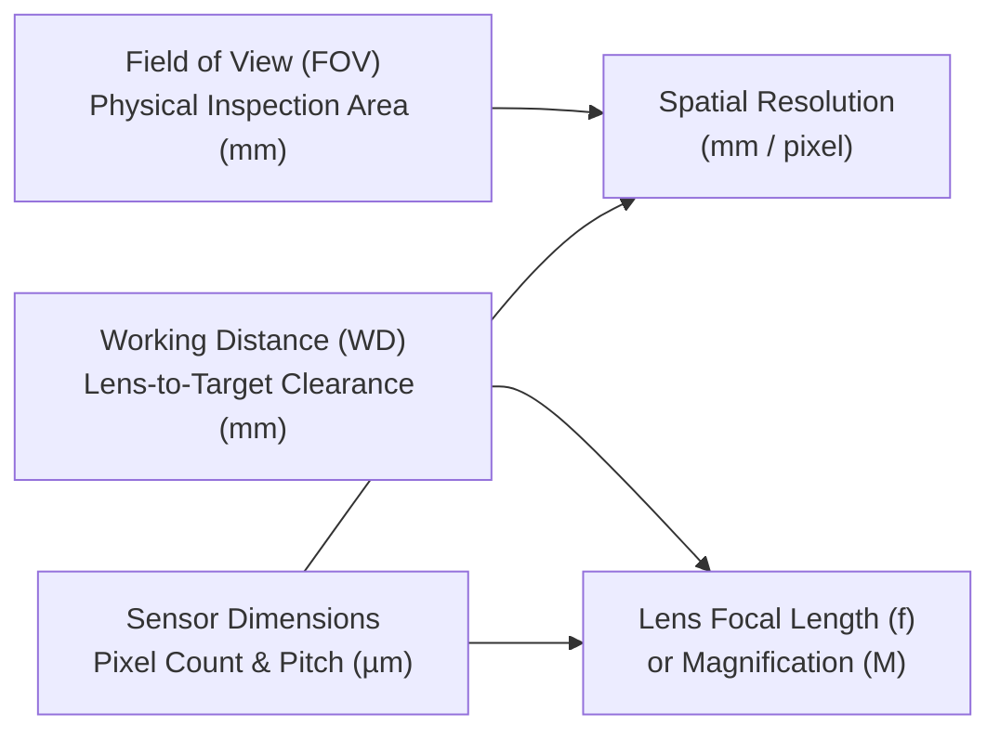
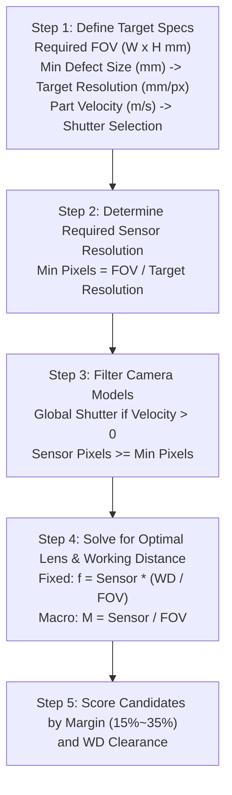

# Concept: Industrial Camera & Lens Optical Selection Matrix

> **Scope**: Basler dart USB3/MIPI Series, C-Mount & Macro Optics, Machine Vision System Sizing  
> **Related Concepts**: [[Camera_Acquisition]], [[Coordinate_Systems_and_Calibration]], [[MTF_and_Optical_Resolution]], [[Industrial_Inspection_Pipelines]]  
> **Database & Engine Artifacts**: `Camera&Lens/optics_database.json`, `Camera&Lens/optics_calculator.py`, `Camera&Lens/lens_selector.html`

---

## 1. Optical Foundations & Metrology Units

In automated optical inspection (AOI) sizing, three fundamental physical quantities govern optical selection:



### Physical Metric Clarification: `mm/pixel` vs `pixels/mm`
> [!IMPORTANT]
> In engineering spreadsheets (such as `Camera&Lens.xls`), the column labeled **`Pixel/mm`** with values like `0.028` represents **`mm/pixel` (Spatial Resolution / Precision)**, not `pixels/mm`.
> 
> - **Spatial Resolution (Precision)**: $\text{Resolution} = \frac{\text{FOV}}{\text{Pixels}}$ (Unit: **$\text{mm/pixel}$** or **$\mu\text{m/pixel}$**).  
>   *Lower values denote finer optical resolution and greater measurement sensitivity.*
> - **Pixel Density**: $\text{Density} = \frac{1}{\text{Resolution}} = \frac{\text{Pixels}}{\text{FOV}}$ (Unit: **$\text{pixels/mm}$**).  
>   *Higher values denote more sensor samples per millimeter of real-world target surface.*

### Nyquist-Shannon Defect Detection Rule
To reliably detect a defect or feature of minimum size $\delta_{\text{min}}$ (e.g., a $0.1\,\text{mm}$ scratch or edge burr), machine vision metrology requires:
$$\text{Resolution (mm/pixel)} \le \frac{\delta_{\text{min}}}{3 \text{ to } 4}$$
*Example*: Detecting a $0.1\,\text{mm}$ particle requires $\le 0.025 \text{ to } 0.033\,\text{mm/pixel}$.

---

## 2. Industrial Camera Baseline Specifications

The baseline database incorporates 8 industrial camera models (Basler dart series) covering rolling and global shutters across multiple sensor formats:

| Model | Shutter Mechanism | Active Pixels ($H \times V$) | Megapixels | Pixel Pitch ($\mu\text{m}$) | Sensor Size ($H \times V$ mm) | Sensor Diag (mm) | Aspect Ratio | Industrial Application Scope |
| :--- | :--- | :--- | :--- | :--- | :--- | :--- | :--- | :--- |
| **`daA3840-45u`** | Rolling | $3840 \times 2160$ | 8.29 MP | $2.00$ | $7.680 \times 4.320$ | $8.814$ | 16:9 | High-res surface inspection, large FOV static inspection |
| **`daA2448-70u`** | Global | $2448 \times 2048$ | 5.01 MP | $2.74$ | $6.708 \times 5.612$ | $8.745$ | 6:5 (Square-like) | High-speed on-the-fly packaging/wafer defect inspection |
| **`daA2500-14u`** | Rolling | $2592 \times 1944$ | 5.04 MP | $2.20$ | $5.702 \times 4.277$ | $7.128$ | 4:3 | High-res cost-effective static PCB inspection |
| **`daA1920-160u`**| Global | $1920 \times 1200$ | 2.30 MP | $3.45$ | $6.624 \times 4.140$ | $7.811$ | 16:10 | High-speed conveyor sorting, motion measurement |
| **`daA1920-30uc`**| Rolling | $1920 \times 1080$ | 2.07 MP | $2.20$ | $4.224 \times 2.376$ | $4.845$ | 16:9 | Low-cost static verification, barcode/OCR reader |
| **`daA1600-60u`** | Global | $1600 \times 1200$ | 1.92 MP | $4.50$ | $7.200 \times 5.400$ | $9.000$ | 4:3 | High sensitivity low-noise inspection (large pixel pitch) |
| **`daA1440-220u`**| Global | $1440 \times 1080$ | 1.56 MP | $3.45$ | $4.968 \times 3.726$ | $6.210$ | 4:3 | Ultra-high framerate (220 fps) motion tracking |
| **`daA720-60u`**  | Global | $720 \times 540$ | 0.39 MP | $6.90$ | $4.968 \times 3.726$ | $6.210$ | 4:3 | Low-cost high-sensitivity presence/absence checking |

### Shutter Architecture Decision:
- **Global Shutter**: Required whenever objects are in continuous motion on conveyors or indexers. Exposure occurs across all pixel rows simultaneously, completely eliminating rolling motion skew and spatial distortion.
- **Rolling Shutter**: Suitable only when objects stop completely before acquisition (indexing stops). Offers higher pixel count at reduced hardware cost.

---

## 3. Lens Categories & Optical Geometry

### Category A: Fixed Focal Length Lenses (C-Mount / CS-Mount)
Fixed lenses utilize standard optical conjugation where magnification scales proportionally with Working Distance (WD):

$$\text{FOV} = \text{Sensor Dimension} \times \left( \frac{\text{WD} + \text{Offset}}{f_{\text{eff}}} \right)$$

$$\text{Resolution (mm/px)} = \text{Pixel Pitch (mm)} \times \left( \frac{\text{WD} + \text{Offset}}{f_{\text{eff}}} \right)$$

| Focal Length ($f$) | Minimum Working Distance ($\text{WD}_{\text{min}}$) | Practical Working Distance Range | Field Expansion Slope ($a \approx 1/f$) | Optical Characteristic |
| :--- | :--- | :--- | :--- | :--- |
| **8 mm** | $50\,\text{mm}$ | $50 \sim 1000\,\text{mm}$ | $0.1250$ | Wide-angle, short WD large FOV, moderate barrel distortion |
| **12 mm** | $50\,\text{mm}$ | $50 \sim 1000\,\text{mm}$ | $0.0834$ | General-purpose standard machine vision focal length |
| **16 mm** | $50\,\text{mm}$ | $50 \sim 1000\,\text{mm}$ | $0.0626$ | Standard low-distortion, high resolution balance |
| **25 mm** | $50\,\text{mm}$ | $50 \sim 1000\,\text{mm}$ | $0.0402$ | Medium telephoto, low geometric distortion |
| **35 mm** | $100\,\text{mm}$ | $100 \sim 1000\,\text{mm}$ | $0.0288$ | High precision gauging at medium working distance |
| **50 mm** | $150\,\text{mm}$ | $150 \sim 1000\,\text{mm}$ | $0.0203$ | Long WD standoff, minimal perspective distortion |
| **100 mm** | $350\,\text{mm}$ | $350 \sim 1000\,\text{mm}$ | $0.0106$ | High standoff distance (e.g. hazardous or thermal isolation) |

### Category B: Macro / Telecentric Optics
Macro and telecentric optics possess a fixed nominal magnification ($M$), independent of mechanical working distance within their depth of field (DoF):

$$\text{FOV}_H = \frac{\text{Sensor}_H}{M}, \quad \text{FOV}_V = \frac{\text{Sensor}_V}{M}$$

$$\text{Resolution (mm/px)} = \frac{\text{Pixel Pitch (}\mu\text{m)}}{M \times 1000}$$

The database includes 19 standardized magnification stops:
`0.10X`, `0.15X`, `0.20X`, `0.25X`, `0.30X`, `0.35X`, `0.40X`, `0.45X`, `0.50X`, `0.55X`, `0.60X`, `0.65X`, `0.70X`, `0.75X`, `0.80X`, `0.85X`, `0.90X`, `0.95X`, `1.00X`.

---

## 4. Key Combination Quick-Reference Matrix

### Representative Fixed Lens Combos ($WD = 200\,\text{mm}$)

| Camera Model | Lens | FOV $H \times V$ (mm) | Spatial Resolution (mm/px) | Pixel Density (px/mm) |
| :--- | :--- | :--- | :--- | :--- |
| **`daA3840-45u`** (8.3 MP) | 8 mm | $250.8 \times 141.1$ | $0.065$ | $15.4$ |
| **`daA3840-45u`** (8.3 MP) | 16 mm | $117.3 \times 66.0$ | $0.031$ | $32.8$ |
| **`daA3840-45u`** (8.3 MP) | 25 mm | $68.8 \times 38.7$ | $0.018$ | $55.6$ |
| **`daA2448-70u`** (5.0 MP Global) | 16 mm | $102.4 \times 85.7$ | $0.042$ | $23.8$ |
| **`daA2448-70u`** (5.0 MP Global) | 25 mm | $60.3 \times 50.4$ | $0.025$ | $40.0$ |
| **`daA1920-160u`** (2.3 MP Global) | 16 mm | $101.2 \times 63.2$ | $0.053$ | $18.9$ |
| **`daA1920-160u`** (2.3 MP Global) | 25 mm | $59.5 \times 37.2$ | $0.031$ | $32.3$ |

### Representative Macro Lens Combos ($0.50\text{X}$)

| Camera Model | Magnification | FOV $H \times V$ (mm) | Spatial Resolution (mm/px) | Resolution in $\mu\text{m}$ |
| :--- | :--- | :--- | :--- | :--- |
| **`daA3840-45u`** | 0.50X | $15.36 \times 8.64$ | $0.0040$ | $4.0\,\mu\text{m/px}$ |
| **`daA2448-70u`** | 0.50X | $13.42 \times 11.22$ | $0.0055$ | $5.5\,\mu\text{m/px}$ |
| **`daA1920-160u`**| 0.50X | $13.25 \times 8.28$ | $0.0069$ | $6.9\,\mu\text{m/px}$ |
| **`daA1600-60u`** | 0.50X | $14.40 \times 10.80$ | $0.0090$ | $9.0\,\mu\text{m/px}$ |

---

## 5. Reverse Selection Optimization Protocol

When sizing a vision station for a new inspection target, follow this 4-step algorithm:



### Python CLI Selection Tool
The repository includes a dedicated CLI calculation and recommendation script at `Camera&Lens/optics_calculator.py`:

```powershell
# 1. Forward Calculation
python.exe -X utf8 "d:\AntiGravity\NIVDM\Camera&Lens\optics_calculator.py" calc --camera daA2448-70u --lens 25mm --wd 200

# 2. Reverse Recommendation
python.exe -X utf8 "d:\AntiGravity\NIVDM\Camera&Lens\optics_calculator.py" recommend --fov-w 80 --fov-h 60 --wd 300 --shutter Global --top 5
```

---

## 6. Dynamic Extensibility: Adding New Cameras

As hardware evolves, new camera models can be added dynamically. Because optical field magnification factors $M_{\text{factor}}(f, \text{WD})$ and macro ratios are sensor-independent properties of the optics, any newly registered camera automatically populates the entire FOV and resolution matrix.

### Adding via CLI:
```powershell
python.exe -X utf8 "d:\AntiGravity\NIVDM\Camera&Lens\optics_calculator.py" add-camera `
  --model "daA4096-30uc" `
  --shutter "Global" `
  --pixels-h 4096 `
  --pixels-v 3000 `
  --pixel-size 3.2
```

### Adding via Interactive Web UI:
Open the embedded UI `Camera&Lens/lens_selector.html`, navigate to the **相機資料庫管理** tab, click **➕ 註冊新相機**, enter the parameters, and all calculators, recommenders, and SVG previews update immediately.
