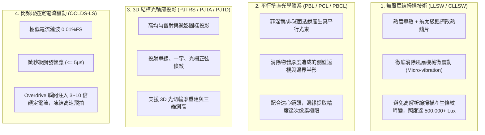

# 2026 極智光電 (Bestin Tech) 機器視覺光源與驅動控制完整選型手冊

> **品牌**: 極智光電股份有限公司 (Bestin Tech Co., Ltd., 創立於 2009 年)  
> **來源資料**: `EDMUNDOPTICS/極智光電.pdf` (102 頁完整產品型錄)  
> **官方網站**: `www.bestintech.com.tw`  
> **關聯概念中樞**: [[Illumination_Techniques]], [[Telecentric_Illumination]], [[Illumination_Techniques_Comparison]], [[Standard_vs_Telecentric_Lighting]], [[Coordinate_Systems_and_Calibration]], [[Chenxuan_Lighting_Catalog]]  
> **結構化資料庫**: `Camera&Lens/bestin_lighting_database.json`

---

## 1. 極智光電核心光學突破與特色優勢 (Core Optical Innovations)

極智光電在工業視覺照明領域具備多項差異化核心技術，特別在**「大型線掃描無風扇散熱」**、**「準直平行光學計量」**與**「3D 結構光輪廓投影」**具有領先優勢：

---

## 2. 極智光電 8 大光源品類與光學架構

### 1. 線掃描光源系列 (Line Scan Lights)
專為高線頻、高速運動之連續捲料（鋼捲、薄膜、紡織、鋰電極片、玻璃基板）設計：
- **`LLSW / LLS-PAR` 系列（無風扇高亮度線光源）**：
  - **核心價值**：傳統大功率線光源依賴風扇強冷，風扇旋轉產生的微小機械共振會直接傳導至光斑，導致 8K/16K 線掃描相機影像產生難以濾除的明暗條紋。極智採用全被動熱管與高導熱純銅/鋁鰭片，**完全無震動、零風扇故障停機風險**。
- **`CLLSW / CLLS-PAR` 系列（無風扇高亮度同軸線光源）**：
  - 集成高精度分光鏡，專門用於**鏡面金屬帶、拋光矽晶圓、反光薄膜**之連續表面刮痕與凹坑檢測。
- **`HILL / CHILL` 系列（超高照度強冷線光 / 同軸線光）**：
  - 配備高靜壓低噪風扇，中心照度可達 **$1,000,000\,\text{Lux}$ 以上**，專配極限線頻（100 kHz+）超高速線上檢測。
- **`TLL / HDLL` 系列（薄型線光源）**：
  - 極限壓縮機身厚度，適用於滾輪縫隙、輸送帶折角等空間極度狹小之處。
- **`DOL` 系列（隧道光源 Tunnel Light）**：
  - 半圓柱隧道形狀漫射腔體，針對圓柱形金屬棒料、管件外壁提供 $360^\circ$ 全方位均勻漫射，消除圓柱反光白線。

---

### 2. 無影漫射光源系列 (Shadowless / Dome Lights)
- **`CNS / HICNS` 系列（環型無影光源）**：內凹擴散板提供高均勻間接光，消除 SMD 零件、接插件引腳之深陰影。
- **`HCNS / LCNS` 系列**：分別提供高角度與低角度均勻無影光。
- **`QNS` 系列（方型無影光源 Square Shadowless）**：
  - 業界少見的**正方形開口無影光源**，專為晶片 Package、BGA、正方形基板與托盤設計，發光利用率大幅優於圓形無影光。
- **`DO` 系列（圓頂無影光源 Dome Light）**：
  - 半球形積分反射，徹底消除金屬球體、易開罐弧面底、藥品泡罩包裝的局部刺眼反光點 (Hotspots)。
- **`AOI` 系列（三色多角度同心圓頂光源）**：
  - 由外至內分為**紅（低角度）、綠（中角度）、藍（高角度）**三層同心環光。利用不同傾斜角度表面反射特定顏色的物理現象，彩色相機單幀即可精準判定 SMT 錫膏爬錫高度與焊點飽滿度。

---

### 3. 同軸光源系列 (Coaxial Lights)
- **`CL / CL2 / CL3 / CLSP` 系列（標準/高照度同軸光源）**：
  - 規格豐富，發光面涵蓋 $20\times 20\,\text{mm}$ 至 $300\times 300\,\text{mm}$ 以上，為晶圓表面、鏡面零件標準配備。
- **`ACL` 系列（轉角同軸光源 Angular Coaxial Light）**：
  - **機構救星**：採用 $90^\circ$ 側向直角出光光路，使原本垂直向上延伸的同軸燈箱轉向水平，**大幅壓縮視覺系統在 Z 軸的機構垂直安裝高度（節省 40%~60% 高度空間）**。
- **`PCL` 系列（平行同軸光源 Parallel Coaxial Light）**：
  - 內建非球面準直鏡，射出高品質平行光，消除散射光造成的假邊緣，專門用於半導體晶圓、精密微結構的次微米尺寸檢測。
- **`PBCL` 系列**：平行同軸落射光與平行透射背光的一體化解決方案。

---

### 4. 環型光源系列 (Ring Lights)
- **`CIR0S` 系列（環型零角度光源 0-Degree Ring Light）**：
  - 光線與被測物表面呈 **$0^\circ$ 極限水平掠射**。任何平滑表面反射的光線完全被拋向水平兩側，相機視野全黑；唯有奈米級微塵、微細刮傷、雷雕淺坑會將光向上散射，是極限暗視野的頂尖利器。
- **`CIR / CIR2` 系列**：標準密集直射明視野環光。
- **`LCIR / LCIR2` 系列**：$15^\circ \sim 30^\circ$ 低角度暗視野環光。
- **`HICIR / HILCIR` 系列**：超高亮度環光，適配短曝光需求。

---

### 5. 條型光源系列 (Bar Lights)
- **`HIREC` 系列（高亮度條型光源）**：內置高效率散熱鋁擠，照度充足，常用於大尺寸 LCD/OLED 面板邊界裂痕檢驗。
- **`REC / REC2` 系列（標準條型光源）**：長度多樣，可靈活搭配偏光板與擴散板。

---

### 6. 背光源系列 (Backlights)
- **`BL / SBL` 系列**：底部直下式與側向導光式均勻背光。
- **`PBL` 系列（平行背光源 Parallel Backlight）**：
  - **高精度計量必備**：採用高品質平行準直菲涅爾透鏡，光線完全垂直穿透工件邊緣，徹底消除一般擴散背光產生的邊緣繞射半影（Penumbra）與圓柱體側壁假輪廓，與遠心鏡頭搭配可達極限幾何重複精度。
- **`HBL / SHBL` 系列（開孔背光源 Hole Backlight）**：
  - 發光板中心預留光學穿透孔，相機鏡頭可透過中央開孔俯視拍攝工件正面，背光源則對工件提供均勻正面反光或作為同軸背向照明。

---

### 7. 點光源與 3D 結構光 (Spot & Structured Lights)
- **`SP / SPL / HISP` 系列**：高功率點光源，專為遠心鏡頭同軸光纖落射孔設計。
- **`PJTRS / PJTA / PJTD` 系列（3D 結構光投影模組 Structured Light）**：
  - **3D 視覺關鍵**：內建高穩定雷射光源或 LED 微影圖樣光學頭，支援投射：
    - **單線 / 十字線**：用於光切法（Light Section Method）輪廓與縫隙深度掃描。
    - **點陣網格 (Dot Matrix)**：用於立體視覺匹配特徵點標定。
    - **正弦條紋 (Sinusoidal Fringe)**：用於相位位移相移法（Phase Shifting）奈米級三維高度表面重建。

---

### 8. 冷光源燈箱與光纖系統 (Light Source Units & Optical Fibers)
- **`LSU / LSU2` 系列（高功率 LED 冷光源燈箱）**：
  - 全固態 LED 冷光，壽命達 30,000 小時以上，取代容易光衰與發熱嚴重的傳統鹵素/金鹵燈。
- **`LSU2-VAR` 系列（可變波長燈箱 Variable Wavelength）**：
  - **多光譜檢測核心**：內部整合多種波段發光晶片（如 UV、藍、綠、紅、NIR），可透過外部通訊指令隨時切換輸出光譜，一套設備即可完成多種不同材質之多光譜分析。
- **`BGF` 系列**：單管、雙管、多叉管與環形石英光纖導光管。

---

## 3. 可程控 LED 驅動器與控制器選用指南 (Programmable LED Drivers)

極智光電的控制器體系以**極致線性度、超低漣波與高速頻閃增強**著稱：

| 控制器型號 | 通道數 | 驅動方式 | 調光解析度 | 關鍵特點與通訊 | 最佳搭配光源 |
| :--- | :--- | :--- | :--- | :--- | :--- |
| **`SCLD LIGHT`** | 1CH | 定電流 (CC) | 類比無段 | 超小型單通道，成本經濟 | 小型點光源、微型環光 |
| **`DCLD3 / DCLD2`** | 2CH | 定電流 (CC) | 256 階 | 數位顯示、RS-232、外觸發光隔離 | 雙條光對稱照明、環光+同軸光 |
| **`QCLD / QCLD2S`** | 4CH | 定電流 (CC) | 256 / 1024 階 | 體積小型化、RS-232 / Ethernet 乙太網 | 4 象限環光、4 條組合矩形光 |
| **`OCLD`** | 8CH | 定電流 (CC) | 256 階 | 8 通道高密度整合，支援多工位 | 複合 AOI 站點、多光源順序切換 |
| **`OCLDS-LS`** | 8CH | **閃頻增強型定電流 (Strobe Overdrive)** | 奈秒/微秒級 | **瞬間注入 3~10 倍額定電流，響應 $\le 5\,\mu\text{s}$** | **高速運動飛拍、超高速線掃描相機** |
| **`SkyDRV`** | 3/6/12CH | 模組化定電流 | 1024 階 | 模組化堆疊，高功率散熱 | 超大面積陣列光源、高瓦數線光 |
| **`CV 系列`** | 1/2/4CH | 定電壓 (CV 24V) | 256 階 | 傳統定電壓燈板通用驅動器 | 標準 24V 燈條、低成本檢驗工位 |
| **`PSU 系列`** | 多通道 | 高瓦數定電流 | 工業級 | **內建智慧風扇轉速監控、模組溫控報警回授** | 24 小時不間斷重負載線掃描檢測 |

---

## 4. 工業視覺檢測問題與極智光電光源解決方案對照表

| 檢驗目標與工件特徵 | 推薦極智光源構型 | 具體推薦型號 | 推薦波長顏色 | 成像物理依據與優勢 |
| :--- | :--- | :--- | :--- | :--- |
| **超高速捲料/鋰電極片線掃描** | 無風扇高亮度線光源 | `LLSW` / `LLS-PAR` | 白光 / 綠光 | 零風扇機械微震動，中心照度破 50 萬 Lux，杜絕線掃描條紋雜訊 |
| **金屬帶鋼/鏡面薄膜連續刮痕** | 無風扇同軸線光源 | `CLLSW` / `CLLS-PAR` | 藍光 / 白光 | 同軸分光鏡使鏡面垂直反射入鏡頭，凹凸微刮痕折射變暗 |
| **精密五金/軸承次像素尺寸量測** | 平行準直背光源 | `PBL 系列` | 紅光 (625nm) / 綠光 | 準直平行光徹底消除邊緣半影與側壁繞射，配合遠心鏡頭精度最高 |
| **機構高度受限之鏡面晶片檢測** | 轉角同軸光源 | `ACL 系列` | 白光 / 藍光 | $90^\circ$ 側向出光折疊光路，Z 軸垂直空間降低 50%，解決機箱干涉 |
| **SMT 焊點錫膏高度與爬錫飽滿度** | 三色多角度同心圓頂光 | `AOI 系列` | RGB 三色同心 | 紅/綠/藍三層不同照射角依焊錫坡度反射特定色彩，單彩色相機判定 |
| **曲面金屬罐底 / 反光鋁箔包裝** | 圓頂積分無影光源 | `DO 系列` (Dome) | 白光 | 半球漫射消除所有高反光亮斑 (Hotspots) 與曲折眩光 |
| **金屬表面極細粉塵 / 淺刮傷** | 環型零角度光源 | `CIR0S 系列` | 藍光 (470nm) | $0^\circ$ 水平貼面掠射，平整面全黑，只有微塵顆粒向上散射亮點 |
| **3D 輪廓掃描 / 膠條塗膠高度** | 3D 結構光投影頭 | `PJTRS` / `PJTD` | 雷射紅光 / 藍光 | 投射高精度雷射光切線或正弦光柵條紋，進行三角光切高度量測 |
| **多材質複合分析 / 多光譜識別** | 可變波長冷光源燈箱 | `LSU2-VAR` + 光纖 | 程式動態切換多波段 | 單一機台動態輸出不同窄波長，分離不同化學成分與吸收峰 |
| **微型工件雙面同時檢測** | 開孔背光源 | `HBL` / `SHBL` | 白光 / 紅光 | 相機透過中心孔正視正面，工件背面由背光源同時提供外形剪影 |

---

## 5. 兩大品牌光學優勢互補矩陣 (Chenxuan vs Bestin Tech)

在為使用者選型時，兩家型錄具備顯著的互補綜效：

| 檢驗場景 / 光學領域 | 宸軒科技 (SAITO) 優勢產品 | 極智光電 (Bestin Tech) 優勢產品 | 最佳推薦策略 |
| :--- | :--- | :--- | :--- |
| **線掃描連續檢測 (Line Scan)** | 集中線光源 (LS/HL) | **無風扇抗震線光 (LLSW)**、同軸線光 (CLLSW) | 若要求超高穩定度與防微震，首選極智 `LLSW` |
| **鏡面同軸檢測 (Coaxial)** | **專利全彩內同軸 (HV-FC)**、高亮外同軸 (IFVL) | **轉角同軸 (ACL)**、平行同軸 (PCL) | 重視演色性選宸軒；重視機構高度與平行光選極智 |
| **精密尺寸量測 (Metrology)** | 標準薄型背光 (TH)、**專利圓形背光 (RFL)** | **平行準直背光 (PBL)**、開孔背光 (HBL) | 圓形料盤選宸軒 `RFL`；厚件消除半影選極智 `PBL` |
| **暗視野瑕疵檢測 (Darkfield)** | **極小直徑 LDR2510 (25mm)**、雙色 HDR-D15 | **極限零角度 CIR0S (0度)** | 極窄空間選宸軒；微塵極限凸顯選極智 `CIR0S` |
| **3D 深度與輪廓檢測 (3D Vision)** | 多角度分象限光度立體法 (MDR) | **3D 結構光投影 (PJTRS / PJTA / PJTD)** | 微小浮雕選宸軒 `MDR`；絕對高度測量選極智結構光 |
| **多光譜分析 (Multispectral)** | UV 紫外 / NIR 紅外系列環光與條光 | **可變波長電控燈箱 (LSU2-VAR)** | 單一波段選宸軒；動態多波段切換選極智 `LSU2-VAR` |
| **高速飛拍頻閃驅動 (Strobe)** | 定電流 SAT-CP 頻閃控制器 | **8通道閃頻增強控制器 (OCLDS-LS)** | 瞬間高倍數 Overdrive 脈衝注入首選極智 `OCLDS-LS` |
