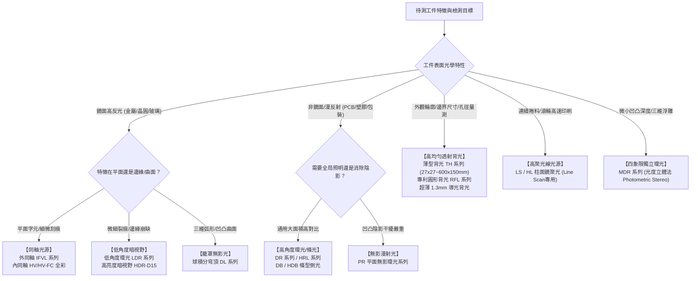

# 2025 宸軒科技 (西藤精密 SAITO) 機器視覺光源完整選型手冊

> **品牌**: 宸軒科技 / 西藤精密 (Saito Precision Co., Ltd.)  
> **來源資料**: `EDMUNDOPTICS/2025宸軒型錄V2.pdf` (80 頁完整規格手冊)  
> **關聯概念中樞**: [[Illumination_Techniques]], [[Telecentric_Illumination]], [[Illumination_Techniques_Comparison]], [[Coordinate_Systems_and_Calibration]], [[Camera_and_Lens_Selection]]  
> **結構化資料庫**: `Camera&Lens/chenxuan_lighting_database.json`

---

## 1. 機器視覺光源選型決策地圖 (Illumination Decision Roadmap)

打光設計是工業機器視覺取像成功率的先決條件（佔 AOI 成敗 70%）。宸軒科技型錄提供齊全的幾何構型與光學控制，可依照待測物的表面反射率、幾何曲面特徵與瑕疵型態進行系統化選型：

---

## 2. 宸軒光源 15 大品類規格矩陣與技術解析

### 1. 外同軸光源 (External Coaxial Light - IFVL / IFS / IFV 系列)
- **光學原理**：內置半透半反分光鏡（Beamsplitter），使發射光與相機鏡頭取像光軸呈 $90^\circ$ 垂直入射與完全重合平行反射，消除鏡面反射造成的反光高光點與周邊陰影。
- **宸軒技術特點**：
  - **IFVL 系列**：照度比傳統同軸光提升 **2 倍以上**，極大縮短曝光時間，徹底滿足高速飛拍需求。
  - **全彩 IFVL-FC 專利**：白光獨立晶粒發光，杜絕傳統 RGB 混光造成的嚴重色偏與機差。
  - **IFS25 配件**：支援固定角度與可變角度側光配件整合，適應空間狹小之複合工位。
- **標準型號與發光面尺寸**：
  - `IFVL18` ($18 \times 18\,\text{mm}$)
  - `IFVL20` ($20 \times 20\,\text{mm}$，提供 FC 全彩)
  - `IFVL25` ($25 \times 25\,\text{mm}$)
  - `IFVL34` ($34 \times 34\,\text{mm}$)
  - `IFVL50` ($50 \times 50\,\text{mm}$，提供 FC 全彩)
  - `IFVL75` ($75 \times 75\,\text{mm}$)
  - `IFVL100` ($100 \times 100\,\text{mm}$)
  - `IFVL150` ($150 \times 150\,\text{mm}$)
  - `IFVL200` ($200 \times 200\,\text{mm}$)
- **典型應用**：晶圓雷雕條碼辨識、拋光金屬表面刮傷、玻璃蓋板平整度、BGA 錫球頂部共面性檢查。

---

### 2. 內同軸點光源 (Internal Coaxial Spot Light - HV / HVD / HV-FC 系列)
- **光學原理**：專為搭配具備同軸照明孔（Coaxial Port）的遠心鏡頭所設計之高聚光點光源。
- **宸軒技術特點**：
  - **HV-FC 專利全彩內同軸**：全球首創四色獨立發光（Red、Green、Blue、White），非 RGB 混成白光，顯色指數高，無光譜畸變。
  - **HV 系列極致照度**：特殊光學聚光鏡片，中心照度高達他廠 2~3 倍，散熱優化防止高溫光衰。
- **代表型號**：
  - `HVD5`（擴散型點光源）
  - `HV5`（標準高聚光點光源，700mA 定電流）
  - `HV`（超高照度點光源，1000mA 定電流）
  - `HV3P`（三晶粒超大光通量點光源）
  - `HV-FC`（專利四色獨立控制全彩內同軸）
- **典型應用**：高倍率遠心精密尺寸量測、半導體打線封裝 (Wire Bonding) 檢驗、微米級晶粒瑕疵檢測。

---

### 3. 高角度環形光源 (High-Angle Ring Light - DR / RL 系列)
- **光學原理**：以 $45^\circ \sim 90^\circ$ 照射角垂直向下均勻照射工件表面，形成直射明視野（Brightfield）。
- **標準型號**：
  - `DR2008` (外徑 $\Phi 20$, 內徑 $\Phi 8\,\text{mm}$)
  - `DR2309` (外徑 $\Phi 23$, 內徑 $\Phi 9\,\text{mm}$)
  - `DR2810` (外徑 $\Phi 28$, 內徑 $\Phi 10\,\text{mm}$)
  - `DR3815` (外徑 $\Phi 38$, 內徑 $\Phi 15\,\text{mm}$)
  - `DR5028` (外徑 $\Phi 50$, 內徑 $\Phi 28\,\text{mm}$)
  - `DR7038` (外徑 $\Phi 70$, 內徑 $\Phi 38\,\text{mm}$)
  - `DR9050` (外徑 $\Phi 90$, 內徑 $\Phi 50\,\text{mm}$)
  - `DR12060` (外徑 $\Phi 120$, 內徑 $\Phi 60\,\text{mm}$)
- **典型應用**：PCB 板插件定位、IC 晶片表面文字辨識 (OCR)、標籤印刷檢測、無反光塑膠零件外觀檢驗。

---

### 4. 低角度環形光源 (Low-Angle Ring Light - LDR 系列)
- **光學原理**：光線以 $0^\circ \sim 30^\circ$ 極低角度沿著表面掠射。平坦表面光線反射至對側視野外（背景全黑），表面突起、邊緣缺口或下陷刮痕則將光線散射進入鏡頭（亮線突出），構成**標準暗視野（Darkfield）**。
- **宸軒技術特點**：
  - **LDR2510**：直徑僅 $25\,\text{mm}$，為**業界最小尺寸低角度環光**，專門適配機械手臂端頭或極窄空間。
  - **雙色系列 (RW/BR/BW)**：紅白、藍紅、藍白獨立交錯排列，利用波長選擇性分離表面色彩。
- **標準型號**：
  - `LDR2510` (外徑 $\Phi 25$, 內徑 $\Phi 10\,\text{mm}$)
  - `LDR4822` (外徑 $\Phi 48$, 內徑 $\Phi 22\,\text{mm}$)
  - `LDR7448` (外徑 $\Phi 74$, 內徑 $\Phi 48\,\text{mm}$)
  - `LDR10068` (外徑 $\Phi 100$, 內徑 $\Phi 68\,\text{mm}$)
  - `LDR132104` (外徑 $\Phi 132$, 內徑 $\Phi 104\,\text{mm}$)
  - `LDR150116` (外徑 $\Phi 150$, 內徑 $\Phi 116\,\text{mm}$)
- **典型應用**：金屬鏡面微細劃傷、玻璃邊緣崩裂 (Chipping)、晶圓表面瑕疵、雷雕點陣碼、瓶口毛邊。

---

### 5. 超高亮度環形光源 (High-Intensity Ring Light - HDR / HRL / DLDR 系列)
- **光學原理**：採用高功率 LED 封裝，搭配光學二次透鏡，照度達傳統環光的 **10 倍以上**。
- **角度系列化**：
  - `HDR-D15` 系列：$15^\circ$ 高亮度暗視野環光（如 `HDR4810D15`, `HDR5618D15`, `HDR7028D15`）。
  - `HRL-D60` 系列：$60^\circ$ 高亮度聚光環光（如 `HRL5944D60`, `HRL7548D60`, `HRL9060D60`, `HRL12075D60`）。
- **典型應用**：AOI 高速線上檢測、焊點錫面形狀判定、紅藍雙色金屬引腳與基板分離。

---

### 6. 無影漫射光源 (Shadowless / Flat Diffuse Light - PR 系列)
- **光學原理**：發光經由特殊倒錐漫射反射罩二次擴散，自各角度均勻投向被測物，消除階梯面或高低差引起的遮蔽陰影。
- **代表型號**：
  - `PR5011` (外徑 $\Phi 50$, 內徑 $\Phi 11\,\text{mm}$)
  - `PR7821` (外徑 $\Phi 78$, 內徑 $\Phi 21\,\text{mm}$)
  - `PR9058` (外徑 $\Phi 90$, 內徑 $\Phi 58\,\text{mm}$)
  - `PR10072` (外徑 $\Phi 100$, 內徑 $\Phi 72\,\text{mm}$)
  - `PR13088` (外徑 $\Phi 130$, 內徑 $\Phi 88\,\text{mm}$)
- **典型應用**：電路板 SMD 零件無影檢測、曲折引腳焊錫飽滿度、具階梯深淺的機械零件表面檢驗。

---

### 7. 長條型側光與高亮度條光 (Bar Light - DB / HDB 系列)
- **光學原理**：線性發光條，可彈性安裝於不同高度與入射角，亦常以 4 條組合成「矩形無影光」。
- **規格體系**：
  - **DB 標準條光**：長度 $50\,\text{mm}$ 至 $300\,\text{mm}$（如 `DB5015`, `DB7530`, `DB10030`, `DB15030`, `DB20030`）。
  - **HDB 超高亮度條光**：照度超傳統 10 倍，配備專利聚焦透鏡（如 `HDB25`, `HDB60`, `HDB100`, `HDB150`, `HDB200`, `HDB300`）。
- **典型應用**：大面積太陽能板邊界裂痕、液晶玻璃基板擦傷、輸送帶大視野條碼讀取。

---

### 8. 多角度分象限光源 (Multi-Quadrant Ring Light - MDR 系列)
- **光學原理**：環光均分為 4 個獨立電氣控制象限。搭配控制器進行 4 象限循序觸發點亮，配合**光度立體法 (Photometric Stereo)** 計算表面法向量向量場。
- **典型應用**：提取微小凹凸瑕疵（如凹痕、突起盲孔、雷雕深淺、布料微結構），完全免疫表面顏色與印刷圖樣干擾。

---

### 9. 高均勻薄型背光源 (Thin Backlight - TH / FL / RFL / 導光系列)
- **光學原理**：工件置於光源上方，利用背後強烈均勻透射光將不透明物體投影為極高對比之黑色輪廓（剪影）。
- **宸軒技術特點**：
  - **尺寸覆蓋最齊全**：方形從 `TH2727` ($27 \times 27\,\text{mm}$) 一路涵蓋至 `TH600150` ($600 \times 150\,\text{mm}$)。
  - **RFL 圓形高均勻背光**：業界首創圓形背光源，專為半導體 8 吋/12 吋晶圓及圓形轉盤設計。
  - **導光型超薄背光**：厚度僅 **$1.3\,\text{mm}$**，在極限機械間隙中實現無干涉安裝。
- **典型應用**：螺紋外徑螺距精密量測、引腳共面度檢驗、針筒液位高度判定、透明薄膜氣泡雜質。

---

### 10. 高聚光線掃描光源 (Concentrated Line Scan Light - LS / HL 系列)
- **光學原理**：玻璃柱面鏡聚焦光學，將所有能量匯聚於寬度僅數公厘的極窄直線光斑上，中心照度可達數十萬 Lux。
- **典型應用**：高速線掃描相機（Line Scan Camera）連續取像、鋼捲/鋁箔連續表面檢測、鋰電極片塗佈均勻度。

---

### 11. 微型高亮度側光 (Mini Side Light - SL 系列)
- **光學原理**：燈體直徑僅 **$17.5\,\text{mm}$**，以特定角度掠射工件表面。
- **典型應用**：極小空間或探針台內部細微缺口與厚度偏差檢驗。

---

### 12. 籠罩型無影光源 (Dome Light - DL 系列)
- **光學原理**：光線向上射入半球形內壁特殊硫酸鋇漫反射層，多次反射後由四面八方包覆工件（半球無影光），消除所有曲面高反光。
- **代表型號**：`DL50`, `DL75`, `DL100`, `DL150`, `DL200`。
- **典型應用**：易開罐曲面底部噴印字符檢查、金屬軸承鋼珠表面凹孔、反光藥品鋁箔泡罩包裝。

---

### 13. 複合整合型光源 (Integrated Multi-Light - MLI 系列)
- **光學原理**：將同軸光源與多角度環形光源集成在單一燈殼中（2~3 通道獨立受控）。
- **典型應用**：單一取像工位需同時檢查「晶片表面平整度（同軸）」與「周邊引腳焊接狀況（環光）」之複合檢測。

---

### 14. 工業調光控制器體系 (Lighting Controllers - CHT / SAT 系列)

| 控制器系列 | 驅動方式 | 通道數 | 關鍵性能參數 | 通訊介面與觸發 |
| :--- | :--- | :--- | :--- | :--- |
| **`CHT-AC-24010-1`** | 定電壓 (CV) | 1CH | 24V 輸出，手動無段旋鈕線性調光 | 外觸發反應時間 $\le 10\,\mu\text{s}$ |
| **`SAT-VP24` 系列** | 定電壓 (CV) | 2CH / 4CH / 8CH | 內置 24V 開關電源，數碼顯示 | RS-232 / RS-485 / 100M Ethernet |
| **`SAT-CP24800R2+`** | **高精定電流 (CC)** | 2CH (卡扣式) | **電流漣波 $\le 0.01\%\text{FS}$**，15段限流 | RS-232 通訊，適合高穩定 AOI |
| **`SAT-CP400/800mini`**| 定電流 (CC) | 1CH 模組 | 400mA / 800mA 可選，0~100% 類比無閃爍調光 | 體積極小，12V~24V 自動調變 |
| **極速頻閃控制器** | 頻閃過載 (Strobe) | 多通道 | **微秒級超載頻閃 (Overdrive 3~5倍瞬間照度)** | 高速輸送帶飛拍極短曝光必備 |

---

### 15. 光學玻璃校正片與光罩 (Calibration Targets & Optical Glass)
- **標準與客製校正板**：提供棋盤格（Checkerboard）、圓點陣列畸變板（Dot Grid Distortion Target）、測微尺與線紋尺。
- **微影精度**：解析度版線寬可達 **$0.001\,\text{mm}$ ($1\,\mu\text{m}$)**。
- **與 NI Vision 整合**：直接對應 `[[imaqLearnCalibrationGrid]]` 與 `[[imaqSetSimpleCalibration]]`，確保影像像素與真實世界的毫米尺寸具備精確線性與畸變修正轉換。

---

## 3. 工業常見瑕疵與最佳光源對照決策表

| 待測瑕疵與物件型態 | 推薦光源構型 | 宸軒推薦型號 | 推薦波長顏色 | 光學成像物理依據 |
| :--- | :--- | :--- | :--- | :--- |
| **晶圓表面劃痕 / 鏡面刮傷** | 低角度暗視野環光 | `LDR4822` / `HDR4810D15` | 藍光 (470nm) | 藍光波長短散射強，低角度使平滑面全黑，劃痕強烈散射亮線 |
| **晶片雷雕字元 / 二維碼** | 外同軸光源 | `IFVL50-W` / `IFVL34` | 白光 (White) | 平行同軸光照射使平整表面均勻反光，凹陷蝕刻點散光變暗形成高對比 |
| **曲面金屬罐底 / 鋼珠凹洞** | 籠罩無影穹頂光 | `DL100` / `DL150` | 白光 / 綠光 | 球積分漫反射光全方位照射，完全消除鏡面高光斑點 (Hotspots) |
| **五金螺絲螺距 / 輪廓量測** | 高均勻薄型背光源 | `TH100100` / `TH150150` | 紅光 (625nm) / 綠光 | 背光透射產生極度銳利之黑色剪影，無表面紋理干擾 |
| **透明塑膠毛邊 / 針筒液位** | 導光超薄背光源 | `EL 系列` / `TH 系列` | 藍光 / 綠光 | 穿透半透明材質，液面月牙弧與毛邊因折射率改變產生深色交界 |
| **PCB 焊點錫膏高度判定** | 雙色獨立高亮度環光 | `HDR-D15 (RW/BR)` | 紅白 / 藍紅雙色 | 利用高低角度與紅藍波長反射角差異，彩色相機直接分離金屬與基板 |
| **表面微小凹坑 / 浮雕文字** | 多角度分象限光源 | `MDR 系列` | 白光 (4象限循序) | 光度立體法 (Photometric Stereo) 提取梯度圖與曲率圖 |
| **鋼板捲料高速連續瑕疵** | 高聚光線掃描光源 | `HL 系列` (搭配柱面鏡) | 白光 / 綠光 | 線掃描高密度能量聚焦，滿足數萬行/秒極短曝光需求 |
