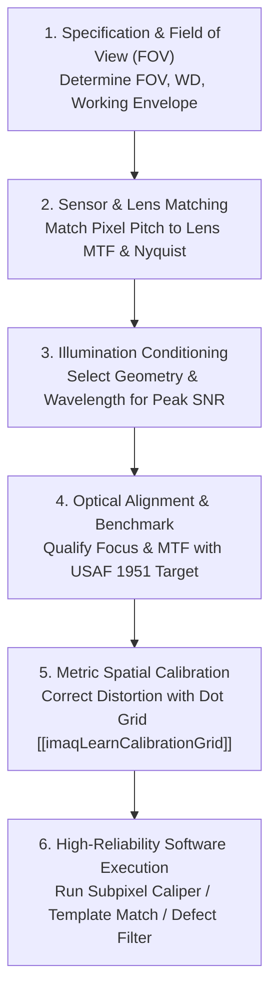
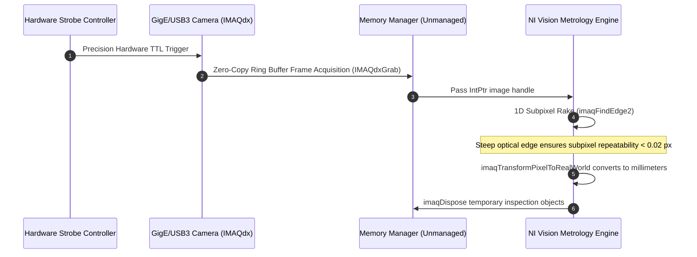

# Synthesis: Optical & Lighting Integration Engineering Guide

> **Scope**: End-to-end engineering methodology bridging physical hardware (Optics, Lighting, Sensors) to the NI Vision software stack  
> **Source Anchor**: Layer 1 Edmund Optics Notes (`[[choose-the-correct-illumination]]`, `[[resolution-and-mtf-testing]]`, `[[testing-and-targets]]`)  
> **Primary Interfaces**: [[Camera_Acquisition]], [[Coordinate_Systems_and_Calibration]], [[Edge_Detection_and_Caliper]], [[Thresholding]]

---

## 1. The Machine Vision Optical Integration Pipeline

A robust vision inspection cell relies on an unbroken chain of optical conditioning, geometric calibration, and software execution:



---

## 2. Step-by-Step Engineering Methodology

### Phase 1: Optical Budget & Magnification Calculation

1. **Calculate Primary Magnification (PMAG)**:
   $$\text{PMAG} = \frac{\text{Sensor Dimension (Horizontal)}}{\text{Field of View (Horizontal)}} = \frac{W_{\text{sensor}}}{W_{\text{FOV}}}$$

2. **Calculate Required Lens Focal Length ($f$)**:
   For standard fixed focal length lenses:
   $$f \approx \frac{\text{WD} \cdot \text{PMAG}}{1 + \text{PMAG}}$$

3. **Check Depth of Field (DOF)**:
   Ensure the part thickness and mechanical positioning jitter fall strictly within the lens optical depth of field:
   $$\text{DOF} \approx \frac{2 \cdot f/\# \cdot c \cdot (1 + \text{PMAG})}{\text{PMAG}^2}$$
   Where $c$ is the circle of confusion (typically $1 - 2\times$ pixel pitch).

---

### Phase 2: Sensor Pixel Pitch vs. Lens MTF Matching

- **Avoid the "Empty Megapixel" Trap**: If the sensor has $p = 2.74 \ \mu\text{m}$ ($f_{\text{Nyquist}} = 182.5 \text{ lp/mm}$), ensure the lens MTF curve guarantees $\ge 25\%$ contrast at $180 \text{ lp/mm}$ across the entire sensor diagonal.
- **Select Optimal Working Aperture**: Keep the lens aperture set to the optical sweet spot ($f/4.0$ to $f/5.6$). Avoid closing past $f/11$ to prevent diffraction-induced edge blur ($d_{\text{Airy}} > 2.44 \lambda \cdot f/\#$).

---

### Phase 3: Lighting Geometry, Polarization & Wavelength Selection

- Consult [[Illumination_Techniques_Comparison]] to match surface properties:
  - For shiny turned pins: Use **Telecentric Backlight** ([[Telecentric_Illumination]]).
  - For curved chrome / solder balls: Use **Diffuse Dome Lighting** or **Cross-Polarization** ($90^\circ$).
  - For polished glass scratches: Use **Low-Angle Darkfield Ring** or **UV ($385\text{ nm}$)**.
  - For internal silicon defects: Use **SWIR ($1150-1450\text{ nm}$)**.
- **Polarization Elimination**: When inspecting shiny metals or soldered PCBs where dome lighting is physically blocked, deploy **Cross-Polarization ($90^\circ$)** (Polarizer on LED + Analyzer on Lens) to extinguish specular hotspots. See [[polarization-and-multispectral-illumination]].
- **Multispectral Wavelength Matching**:
  - UV ($365\text{ nm}$): Fluorescent conformal coating and adhesive dispensing verification.
  - NIR ($850\text{ nm}$): Pair with an $850\text{ nm}$ bandpass filter to achieve complete factory ambient light immunity and penetrate dark plastic housings.
  - Blue ($470\text{ nm}$): Minimizes Airy disk diffraction blur ($d \propto \lambda$) for high-precision metrology.

---

### Phase 4: Spatial Metric Calibration via NI Vision

```csharp
// Industrial C# NI Vision Spatial Calibration Sequence
using NationalInstruments.Vision;
using NationalInstruments.Vision.Analysis;

public class OpticalCalibrationEngine
{
    public static void PerformDotGridCalibration(VisionImage rawGridImage, double gridSpacingMm)
    {
        // 1. Define Grid Feature Parameters
        var gridOptions = new GridCalibrationOptions
        {
            UnitOfMeasure = "mm",
            GridSpacing = gridSpacingMm,
            CalibrationType = CalibrationType.NonlinearDistortion
        };

        // 2. Automatically detect dot centroids and compute polynomial radial distortion
        Algorithms.LearnCalibrationGrid(rawGridImage, gridOptions);

        // 3. Image now possesses an internal Calibration Template
        // Pixel coordinates are transformed to calibrated millimeters transparently
    }
}
```

---

### Phase 5: Acquisition & Subpixel Inspection Tuning



---

## 3. Production Troubleshooting Diagnostic Tree

| Symptom in NI Vision | Optical Root Cause | Engineering Remedy |
| :--- | :--- | :--- |
| **Gauged diameter is smaller than physical part** | Glancing sidewall scattering under diffuse backlight | Replace with [[Telecentric_Illumination]] |
| **Subpixel edge position fluctuates ($\sigma > 0.2\text{ px}$)** | Lens MTF too low or lens stopped down past diffraction limit ($f/16$) | Open aperture to $f/4.0-f/5.6$; replace with higher MTF optic |
| **Edge position drifts over time / Shift work failure** | Ambient lighting fluctuations (sunlight / overhead factory lamps) | Switch to $850\text{ nm}$ NIR illumination with matching narrow bandpass filter |
| **High failure rate in global thresholding (Hotspots)** | Specular glare on shiny solder, metallic cylinders, or blister packs | Deploy **Cross-Polarization ($90^\circ$)** filter pair or Diffuse Dome |
| **Cannot detect transparent glue dispensing path** | Glue has near-identical refractive index as substrate | Add UV fluorescent tracer dye and illuminate with $365\text{ nm}$ UV |
| **Cannot see internal clips inside dark consumer product** | Dark plastic housing absorbs all visible light | Switch to $850\text{ nm} - 940\text{ nm}$ NIR to penetrate plastic |
| **Corners of image appear dark (Vignetting)** | Lens image circle smaller than sensor format | Upgrade lens to match sensor format ($2/3"$, $1"$, or $1.1"$) |

---

## 4. Associated Wiki Pages

- **Core Concepts**:
  - [[Illumination_Techniques]]
  - [[Telecentric_Illumination]]
  - [[MTF_and_Optical_Resolution]]
  - [[Optical_Targets_and_Testing]]
- **Comparisons**:
  - [[Illumination_Techniques_Comparison]]
  - [[Standard_vs_Telecentric_Lighting]]
- **Software Pipelines**:
  - [[Industrial_Inspection_Pipelines]]
  - [[Memory_Management_and_Disposal_Rules]]
