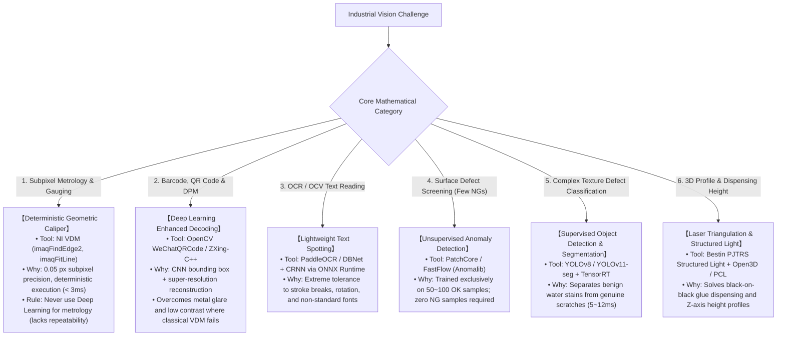

# Architecture Synthesis: Pragmatic Industrial Vision Arsenal & Tool Selection

> **Philosophy**: Tool-agnostic, results-driven engineering. In modern automated optical inspection (AOI), forcing a single library (NI VDM, OpenCV, or Deep Learning) across all vision tasks causes production bottlenecks. Deploying the optimal mathematical tool for each specific problem maximizes both throughput and reliability.  
> **Related Syntheses**: [[Hybrid_Vision_Architecture_VDM_and_OpenCV]], [[Industrial_Inspection_Pipelines]], [[Optics_and_Lighting_Integration_Guide]]  
> **Related Concepts**: [[Edge_Detection_and_Caliper]], [[Coordinate_Systems_and_Calibration]], [[Camera_Acquisition]]

---

## 1. The Right Tool for the Right Task



---

## 2. Technology Benchmark & Trade-off Matrix

| Inspection Task Domain | Why Rule-Based (VDM/OpenCV) Fails | Why Pure Deep Learning Fails | The Winning Pragmatic Architecture |
| :--- | :--- | :--- | :--- |
| **Critical Dimension Metrology** | Works well when contrast is clear. | **AI is a black box without subpixel mathematical proof; cannot guarantee $\pm 0.005\,\text{mm}$ repeatability.** | **NI VDM Subpixel Caliper** (`imaqFindEdge2`, `imaqFitCircle2`) |
| **Laser DPM QR Code on Metal** | **Finder pattern scanning breaks on glare, tilt, and surface scratches.** | Works extremely well. | **OpenCV WeChatQRCode** (Zero-copy bridged from IMAQdx) |
| **Dot Peen & Stamped OCR** | **Rigid template matching breaks when character spacing or font weight varies.** | Works extremely well. | **PaddleOCR / ONNX Runtime** |
| **Defect Screening with Scarce NGs** | Manually tuned thresholds cause high false reject rates (overkill). | **Supervised AI cannot train without hundreds of defect samples.** | **PatchCore / Anomalib** (Unsupervised anomaly detection trained on OK only) |
| **Glue Bead Height / 3D Dispensing** | 2D grayscale cameras have zero Z-axis depth information. | 2D AI cannot compute physical metric height. | **3D Structured Light / Laser Sheet Triangulation** |

---

## 3. High-Throughput Two-Stage Production Pipeline

To maintain 600+ PPM (Parts Per Minute) on industrial lines, cascade rule-based filtering with AI deep learning inference:

```mermaid
sequenceDiagram
    participant Cam as Industrial Camera (IMAQdx)
    participant Stage1 as Stage 1: NI VDM (Ultra-Fast Rule Filter)
    participant Stage2 as Stage 2: Deep Learning (High-Precision AI)
    participant Actuator as Reject Mechanism / PLC

    Cam->>Stage1: Grab Frame via Zero-Copy Buffer (0.00 ms)
    Stage1->>Stage1: Run Subpixel Caliper Gauging (2~4 ms)
    alt Dimension Out of Tolerance (Clear Defect)
        Stage1->>Actuator: Direct NG Trigger (Rejects part immediately; saves AI GPU cycle)
    else Dimension Pass (Ambiguous Defect Inspection Area)
        Stage1->>Stage2: Pass Cropped ROI to YOLO / PatchCore / WeChatQRCode (10~15 ms)
        Stage2->>Actuator: Output Defect Classification & Traceability Data to MES
    end
```
