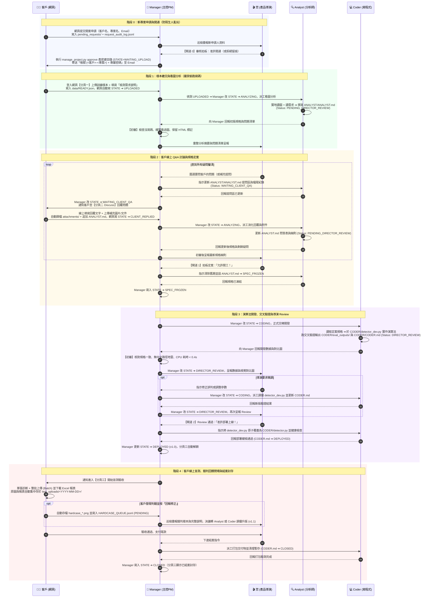

# 🔄 MetaVision AOI — 五方角色交互流程總覽 (WORKFLOW OVERVIEW)

> **參與角色**：
> - **👨‍💼 Client（客戶）**：只操作瀏覽器三分頁網頁（免裝軟體、免懂技術）
> - **🎬 Director（您 / 產品導演）**：掌握三大關鍵決策閘道，看重點報告拍板定案
> - **👔 Manager（主控 Agent / PM）**：唯一總控中樞，巡檢狀態機、**單一寫入 `STATE.json`**、自動派工、初審品質與對您彙報
> - **🔍 Analyst（`aoi_analyst` 分析師）**：看圖分析、提問、記錄討論、寫定案規格（嚴禁寫碼、嚴禁改 `STATE.json`）
> - **💻 Coder（`aoi_coder` 開發工程師）**：見 `SPEC_FROZEN` 才開工，於 `detector_dev.py` 開發驗證，過 Review 才原子覆蓋 `detector.py` 上線（嚴禁改 `STATE.json`）

---

## 一、 全生命週期交互時序圖 (Sequence Flow)



---

## 二、 您的三大決策閘道（Human-in-the-Loop 精華）

平常繁瑣的收圖、讀圖、催問、寫碼、驗證、存檔都由 AI 團隊自動運作，**您（產品導演）只需要在 3 個最關鍵的時刻拍板**：

| 閘道 | 時機 | 您看什麼 | 拍板動作 |
| :--- | :--- | :--- | :--- |
| **閘道 0：准開案** | 新客戶填表申請帳號 | Manager 彙報的客戶名、專案名、Email | 說「准」（產密通知）或「拒」（寫入稽核日誌） |
| **閘道 1：准開工** | Analyst 看圖與客戶 Q&A 完成 | `ANALYST/ANALYST.md`（執行細則 + 問答紀錄） | 確認沒疑問 ➔ 下令 **`SPEC_FROZEN`** 交棒 Coder |
| **閘道 2：准上線** | Coder 完成演算法與本機驗證 | `CODER/CODER.md`（量化數據 + 對比圖） | Review 滿意 ➔ 下令 **`DEPLOYED`** 解鎖分頁三盲測 |

---

## 三、 各角色紅線、狀態命名與專屬文件速查

| 角色 | 專屬 SOP | 維護檔案 | 絕對紅線 |
| :--- | :--- | :--- | :--- |
| **👔 Manager** | [AI_MANAGER_SOP.md](./AI_MANAGER_SOP.md) | `STATE.json`（唯一內部寫入者）、`projects_registry.json`、`request_audit_log.jsonl` | 不可跳過導演三大閘道；不越權代寫演算法 |
| **🔍 Analyst** | [AI_ANALYST_SOP.md](./AI_ANALYST_SOP.md) | `ANALYST/ANALYST.md`（規格＋提問＋討論合一）、`attachments/<YYYY-MM-DD>/` | **嚴禁寫或改 `.py` 程式碼與 `STATE.json`**；一律先向 Manager 回報 |
| **💻 Coder** | [AI_CODER_SOP.md](./AI_CODER_SOP.md) | `CODER/CODER.md`、`detector_dev.py`、`detector.py`、`eval_outputs/` | **未見 `SPEC_FROZEN` 嚴禁開工**；未過 Review 嚴禁覆蓋 `detector.py`；禁用 `cv2.imread/imwrite`；一律先向 Manager 回報 |
| **👨‍💼 Client** | [CLIENT_SOP.md](./CLIENT_SOP.md) | 僅透過網頁操作 `data/`、`ANALYST/`、`test_uploads/` | 未獲審核密碼前無法進入任何專案分頁 |

---

## 四、 專案標準目錄結構

```text
d:\AntiGravity\HFAOAIDelivery\
├── app.py                       # 多專案共用三分頁入口網站 (Port 8088 / HF Space 7860)
├── manage_project.py            # 開案看板、審核核准 (approve) / 拒絕 (reject) / 手動建案 (create)
├── projects_registry.json       # 已開通專案帳密表（帳號 = <客戶名稱>-<客戶專案>）
├── request_audit_log.jsonl      # 永久申請稽核日誌 (REQUESTED / APPROVED / REJECTED / CREATED)
├── pending_requests/            # 待審核新客戶開案申請 (<客戶名稱>-<客戶專案>.json)
└── projects/
    └── <客戶名稱>-<客戶專案>/
        ├── STATE.json           # 【Manager 唯一內部寫入】單一進度事實來源 (10 種標準 stage / version)
        ├── data/                # 【訓練樣本】raw/<類別>/<YYYY-MM-DD>/ + READY.json
        ├── ANALYST/             # 【Analyst 專屬】ANALYST.md（三合一）、CLIENT_REPLIED.json、attachments/<YYYY-MM-DD>/
        ├── CODER/               # 【Coder 專屬】CODER.md、detector_dev.py、detector.py、eval_outputs/
        └── test_uploads/        # 【線上盲測】<YYYY-MM-DD>/{single,batch_HHMMSS}/ 原圖、同日根層 Excel 與 hardcase_*.png + HARDCASE_QUEUE.jsonl
```
